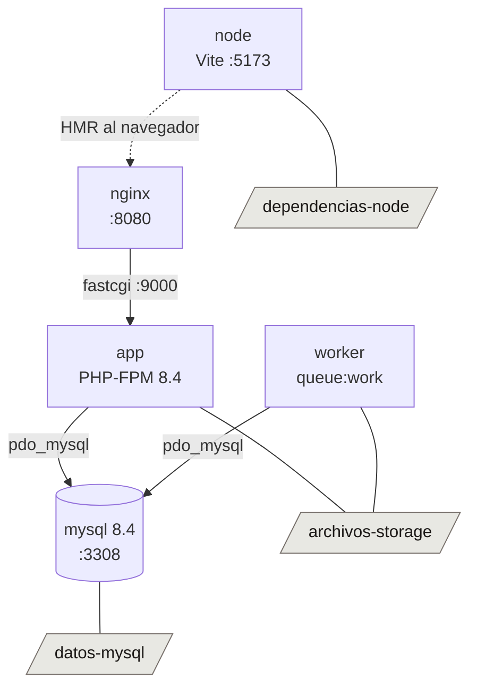

# Entorno de desarrollo

Todo el proyecto corre dentro de Docker. No hace falta PHP, Node ni MySQL
instalados en el host: solo Docker y `make`.

---

## Requisitos del host

| Herramienta | Version verificada | Para que |
|---|---|---|
| Docker Engine | 29.6.2 | Ejecutar los contenedores |
| Docker Compose | v5.3.1 (plugin `docker compose`) | Orquestar los cinco servicios |
| GNU Make | 4.4.1 | Atajos del `Makefile` |

Puertos que deben estar libres en el host: **8080** (web), **3309** (MySQL) y
**5173** (Vite). El **3307** lo ocupa el MySQL de otro proyecto de esta misma
maquina; por eso este stack no lo usa.

---

## Levantar el proyecto desde cero

```bash
cp .env.example .env          # completar APP_KEY, DB_PASSWORD y DB_ROOT_PASSWORD
make build                    # construye las imagenes app, worker y node
make up                       # levanta los cinco servicios
docker compose exec app php artisan key:generate
make migrate                  # crea las tablas
```

La aplicacion queda en <http://localhost:8080>.

Para detener sin perder datos:

```bash
make down
```

Los tres volumenes nombrados sobreviven a `make down`. Para borrarlos de verdad
hace falta `docker compose down -v`, que **destruye la base de datos y los
archivos subidos**.

---

## Acceso desde Windows

El proyecto corre en WSL2 (AlmaLinux 10) en modo NAT con
`localhostForwarding=true` en el `.wslconfig` de Windows. Eso da dos rutas de
acceso equivalentes desde Windows:

| Servicio | Por `localhost` (recomendada) | Por la IP del WSL |
|---|---|---|
| Aplicacion | <http://localhost:8080> | `http://<IP-WSL>:8080` |
| MySQL | `localhost` puerto **3309** | `<IP-WSL>` puerto **3309** |
| Vite (HMR) | <http://localhost:5173> | `http://<IP-WSL>:5173` |

La IP del WSL **cambia en cada reinicio**. Para consultarla:

```bash
hostname -I | awk '{print $1}'          # desde WSL
```

```powershell
wsl hostname -I                          # desde PowerShell en Windows
```

Por eso `localhost` es la ruta preferida: no depende de una IP que se mueve.

### Conexion desde DBeaver

| Campo | Valor |
|---|---|
| Driver | MySQL 8 |
| Host | `localhost` (o la IP del WSL) |
| Puerto | **3309** |
| Base de datos | `gestor_tareas` |
| Usuario | `gestor` (el de `DB_USERNAME`) |
| Contrasena | la de `DB_PASSWORD` en `.env` |

Con esos datos basta: **no hace falta tocar Driver properties**. El servidor
trae TLS activo (`TLSv1.2,TLSv1.3`) y DBeaver negocia una conexion cifrada por
defecto, que es lo que `caching_sha2_password` necesita para autenticar.

El usuario `gestor` existe con host `%`, asi que acepta conexiones remotas sin
configuracion extra. No hay firewall activo dentro del WSL (`firewalld` esta
inactivo y la politica de `INPUT` es `ACCEPT`).

> **Si desactivas SSL, la conexion se rompe.** Con `useSSL=false` /
> `sslMode=DISABLED` y la cache de autenticacion fria (justo tras levantar el
> contenedor) MySQL responde:
> `Authentication plugin 'caching_sha2_password' reported error: Authentication
> requires secure connection`.
> La solucion es dejar SSL activo, no anadir `allowPublicKeyRetrieval`.

> **Ojo con el puerto.** DBeaver se conecta al **3309** (el publicado en el
> host). Dentro ese servidor reporta `@@port = 3308`, que es el puerto real de
> `mysqld`. No es un error: son los dos lados del mapeo `"3309:3308"`.

### Acceso desde otras maquinas de la red

Solo funciona para la aplicacion y MySQL, y requiere un `netsh portproxy` en
Windows apuntando a la IP del WSL. El dev server de Vite **no** sirve para eso:
en modo desarrollo Laravel emite los assets contra `http://localhost:5173`
(ver `public/hot`), que fuera de la maquina no resuelve. Para eso hay que
compilar con `npm run build`.

---

## Servicios

| Servicio | Imagen | Puerto host | Rol |
|---|---|---|---|
| `app` | `gestor-tareas-app` (desde `docker/php/Dockerfile`, base `php:8.4-fpm`) | — (9000 interno) | PHP-FPM |
| `nginx` | `nginx:alpine` | 8080 → 80 | Servidor web |
| `mysql` | `mysql:8.4` | 3309 → 3308 | Base de datos |
| `node` | `gestor-tareas-node` (desde `docker/node/Dockerfile`, base `node:22-alpine`) | 5173 | Vite en modo desarrollo |
| `worker` | `gestor-tareas-app` (misma imagen que `app`) | — | `php artisan queue:work` |
| `humo` | `mcr.microsoft.com/playwright:v1.62.1-noble` | — | Comprobacion de humo. **Perfil `humo`**: no se levanta con `docker compose up` |

### Volumenes nombrados

| Volumen | Monta en | Guarda |
|---|---|---|
| `datos-mysql` | `/var/lib/mysql` | La base de datos |
| `archivos-storage` | `/var/www/html/storage/app` | Los archivos subidos |
| `dependencias-node` | `/var/www/html/node_modules` | `node_modules` |

El codigo fuente va como bind mount (`.:/var/www/html`) para desarrollo en
caliente.

### Dependencias entre servicios



---

## Donde vive cada archivo de configuracion

| Archivo | Que controla |
|---|---|
| `docker-compose.yml` | Servicios, puertos, volumenes, healthchecks |
| `docker/php/Dockerfile` | Imagen de `app` y `worker`: extensiones PHP, Composer, UID/GID |
| `docker/php/php.ini` | Limites de subida, memoria, timeouts y zona horaria de PHP |
| `docker/nginx/default.conf` | Vhost, `client_max_body_size`, timeout de FastCGI |
| `docker/node/Dockerfile` | Imagen de `node`: Node 22 mas un PHP-CLI para Wayfinder |
| `.env` | Conexion a la base, locale, zona horaria, drivers de cola/cache/sesion |
| `Makefile` | Atajos (`up`, `down`, `fresh`, `test`, `pint`, `shell`, `logs`, `hooks`) |
| `docker/git-hooks/pre-commit` | Hook de Git que verifica el formato con Pint; se instala con `make hooks` |

---

## Limites de subida

El usuario sube imagenes de hasta 5 MB y respaldos `.sql` de hasta 250 MB.
Ese limite vive en **cuatro sitios** que deben cambiarse juntos:

1. `docker/php/php.ini` → `upload_max_filesize`, `post_max_size`
2. `docker/nginx/default.conf` → `client_max_body_size`
3. Las reglas de validacion de Laravel *(se configuran en la fase 10)*
4. Las colecciones de Medialibrary *(se configuran en la fase 10)*

Cambiar uno solo produce fallos silenciosos que parecen bugs de la aplicacion:
Nginx corta la peticion antes de que PHP la vea, o PHP la descarta antes de que
la validacion se ejecute.

---

## Comprobacion de humo (`make humo`)

```bash
make humo
```

Levanta un navegador de verdad, recorre cinco pantallas —tablero, clientes,
proyectos, detalle de proyecto y listado de tareas— a tres anchos (360, 768 y
1440) en claro y en oscuro, y **falla** si encuentra cualquiera de estas dos
cosas:

1. Texto visible con forma de clave de traduccion: una cadena sin espacios con
   dos o mas segmentos separados por puntos (`nav.dashboard`).
2. Desbordamiento horizontal del documento (`scrollWidth > clientWidth` en la
   raiz). Que una tabla se desplace dentro de su panel es correcto; que la
   pagina entera se vaya a la derecha, no.

**No es una suite end-to-end y no debe crecer hasta serlo.** Existe porque las
fases 04 y 07 se cerraron en verde con la aplicacion mostrando sus claves en
crudo: `npm run build` compila igual de bien y ninguna prueba de servidor mira
el texto. Lo que valida el comportamiento son las pruebas de Pest.

Necesita los servicios levantados. El objetivo compila los assets primero y
corre **contra el build, no contra el dev server**: la URL que Vite escribe en
`public/hot` es `localhost:5173`, que dentro de la red de Compose es el propio
contenedor de la comprobacion. Ademas es la version que vale, porque el escaner
de Tailwind solo falla en el build de produccion.

### Donde quedan las capturas

| Ruta | Que hay |
|---|---|
| `storage/humo/capturas/` | Una PNG por pantalla, ancho y tema: `tareas-360-dark.png` |
| `storage/humo/resultados/` | Lo que Playwright guarda de un fallo |
| `storage/humo/sesion.json` | La cookie de sesion, reutilizada por las seis comprobaciones |

Todo `storage/humo` esta en `.gitignore`: son artefactos.

**Mira las capturas.** La comprobacion dice que nada esta roto, no que algo este
bien: las mayusculas inconsistentes de las cabeceras de tabla pasaban las dos
comprobaciones y solo se vieron mirando una PNG.

La sesion se abre **una sola vez**, en el `globalSetup`: Fortify limita los
intentos de acceso y seis autenticaciones seguidas agotan el cupo.

### Credenciales

Salen de `DesarrolloSeeder` y se pueden cambiar por entorno:

| Variable | Por defecto |
|---|---|
| `HUMO_URL` | `http://nginx` |
| `HUMO_CORREO` | `admin@gestor.test` |
| `HUMO_CLAVE` | `password` |

---

## Traducciones: como se generan y como anadir una clave

Las traducciones de la interfaz viven en `lang/es/*.php` y `lang/en/*.php`. El
cliente no lee esos archivos: el plugin de Vite de `laravel-vue-i18n` los
compila a **`lang/php_es.json` y `lang/php_en.json`**, que estan en
`.gitignore` porque son artefactos.

### Que los genera, y la trampa

El plugin los escribe en `buildStart` y **los borra en `buildEnd`**. Eso
significa que `npm run build` los deja fuera del disco al terminar. Para el
propio build no importa —el JSON queda inlineado en los chunks—, pero **un dev
server que ya estuviera corriendo se queda sin diccionario**: el `import()` de
`lang/php_es.json` devuelve 404, el paquete se traga el fallo y toda la interfaz
pinta su clave en crudo.

Es exactamente lo que le paso a las fases 04 y 07: la verificacion de cada fase
es `docker compose exec node npm run build`, y se ejecuta con `docker compose
up` levantado.

Lo arregla un plugin propio de tres lineas en `vite.config.ts`
(`regenerarTraducciones`), que los vuelve a escribir en `closeBundle`, que corre
despues de `buildEnd`. Si alguna vez vuelven a faltar, reiniciar el servicio
`node` tambien los regenera:

```bash
docker compose restart node
```

### Anadir una clave nueva

1. Anadela a `lang/es/<grupo>.php` **y a `lang/en/<grupo>.php`, en el mismo
   commit**. Se admite el texto en espanol como valor provisional en `en`.
2. Usala desde el componente con `$t('grupo.clave')`, o con `trans()` importado
   de **`@/lib/i18n`**, nunca del paquete: el envoltorio avisa por consola y la
   marca en pantalla como `⟦grupo.clave⟧` cuando no resuelve. Hay una regla de
   ESLint que lo impide.
3. Corre `php artisan test --filter=CoberturaDeClaves`. Falla si la clave no
   existe en los dos idiomas, si un prefijo compuesto en ejecucion
   (`` $t(`enums.estado_tarea.${estado}`) ``) no corresponde a ningun grupo, o
   si `es` y `en` dejan de tener exactamente las mismas claves.

Esa misma prueba **informa** —sin fallar— de las claves definidas que nadie usa.
No falla porque hay claves que resuelve el servidor con `__()` y otras que
esperan a una fase posterior.

Las tres redes son independientes y hacen falta las tres:

| Red | Donde salta | Que caza |
|---|---|---|
| `CoberturaDeClavesTest` | `php artisan test` | Claves que faltan en `es` o en `en` |
| Modo estricto de `@/lib/i18n` | Navegador, en desarrollo | Cualquier clave que no resuelva, sea cual sea el motivo |
| `make humo` | Navegador, contra el build | Lo mismo, ya en la pantalla, en cinco pantallas |

---

## Problemas frecuentes

### 1. `SQLSTATE[HY000] [2002] Connection refused` al conectar a la base

`DB_HOST` esta mal puesto. Dentro de los contenedores la base **no** esta en
`127.0.0.1`: ahi vive el propio contenedor. El valor correcto es el nombre del
servicio de Compose:

```env
DB_HOST=mysql
DB_PORT=3308
```

`mysqld` escucha en **3308**, no en 3306: el servicio arranca con
`command: ["--port=3308"]`. El puerto **3309** es el publicado en el host, solo
para clientes externos: `mysql -h 127.0.0.1 -P 3309 -u gestor -p`.

### 2. Los archivos subidos desaparecen al reiniciar

El bind mount del codigo (`.:/var/www/html`) sobrescribe `storage/app` si el
volumen `archivos-storage` no se monta **despues**. En `docker-compose.yml` el
orden correcto es:

```yaml
volumes:
  - .:/var/www/html                              # primero el codigo
  - archivos-storage:/var/www/html/storage/app   # despues el volumen
```

Para comprobarlo, escribe un archivo en `storage/app`, ejecuta
`docker compose down && docker compose up -d` y confirma que sigue ahi.

### 3. `Permission denied` al escribir en `storage/app`

El volumen `archivos-storage` hereda contenido **y permisos** del path
`/var/www/html/storage/app` tal como existe en la imagen. Si ahi pertenece a
root, el volumen nace de root y el contenedor (que corre como UID 1000) no puede
escribir. Por eso `docker/php/Dockerfile` crea el arbol de `storage/` y hace
`chown -R www-data:www-data /var/www` **antes** de que Docker inicialice el
volumen.

Si el error aparece igualmente, el volumen se creo con una imagen antigua.
Se corrige recreandolo (destruye los archivos subidos):

```bash
docker compose down
docker volume rm gestor_tareas_archivos-storage
docker compose up -d
```

### 4. Choque de puertos con otro MySQL de la maquina

Este stack no toca 3306 ni 3307. `mysqld` escucha en **3308** dentro de la red
de Compose y se publica en **3309** en el host, asi que convive con el otro
proyecto que ya ocupa el 3307. Cuatro sitios describen ese puerto y deben
moverse juntos:

1. `docker-compose.yml` → `command: ["--port=3308"]` (puerto interno)
2. `docker-compose.yml` → `ports: - "3309:3308"` (lado derecho = interno)
3. `docker-compose.yml` → `-P 3308` en el healthcheck de `mysqladmin`
4. `.env` → `DB_PORT=3308`

Desalinear uno deja el contenedor `unhealthy` o a Laravel con
`Connection refused`, sin que el error apunte a la causa.

---

## Recuperacion: volver al estado de una fase

El proyecto esta bajo Git desde la fase 06 y cada fase cerrada deja una etiqueta
(`fase-06`, `fase-07`, ...). La convencion completa esta en
[`04-control-de-versiones.md`](04-control-de-versiones.md); aqui solo el
procedimiento de rescate.

### Ver como estaba el codigo al cerrar una fase

```bash
git tag -l                       # que fases hay etiquetadas
git switch --detach fase-09      # el codigo tal y como quedo al cerrar la fase 09
git switch -                     # volver a donde estabas
```

Esto **solo mueve el codigo**. La base de datos y los archivos subidos viven en
volumenes de Docker y no retroceden con el codigo: si la fase que buscas tenia un
esquema distinto, hace falta ademas `make fresh`, que **destruye los datos
actuales**.

### Deshacer una fase entera ya fusionada

Cada fase entra en `main` con un merge `--no-ff`, asi que es un solo nodo:

```bash
git log --oneline --merges       # localizar el commit de merge de la fase
git revert -m 1 <sha-del-merge>
```

### Recuperar un archivo borrado por error

```bash
git restore <ruta>                       # si aun no se habia commiteado el borrado
git restore --source=HEAD~1 <ruta>       # si ya se commiteo
```

### Lo que Git no recupera

Git versiona **codigo**, no datos. Quedan fuera y necesitan su propio respaldo:

| Que | Donde vive | Se pierde con |
|---|---|---|
| Base de datos | volumen `datos-mysql` | `docker compose down -v`, `make fresh` |
| Archivos subidos | volumen `archivos-storage` | `docker compose down -v` |
| `.env` | solo en el host | borrarlo; se reconstruye desde `.env.example` |

---

## Notas de implementacion

- **El contenedor `node` lleva un PHP-CLI.** El plugin de Vite de Wayfinder
  ejecuta `php artisan wayfinder:generate` al arrancar el dev server. Sin PHP en
  esa imagen, Vite falla con `Error: Command failed: php artisan
  wayfinder:generate` / `php: not found`.
- **`app` y `worker` corren con el UID/GID del host** (variables `UID` y `GID`
  del `.env`, 1000 por defecto). Sin eso, los archivos que los contenedores
  escriben en el bind mount quedan como `root` y el host no los puede editar.
- **La comprobacion de humo no corre en el contenedor `node`.** Ese es Alpine y
  Playwright no soporta musl: sus navegadores son binarios contra glibc. El
  servicio `humo` usa la imagen oficial, que ya los trae instalados, y sus
  dependencias van a `tests/humo/node_modules` en lugar de al volumen
  `dependencias-node`: ese arbol lo instalo Alpine y mezclarlos rompe los dos.
- **No se usa Laravel Sail**: se necesita control explicito de Nginx y de los
  limites de subida.
- **No se usa Redis.** Colas, cache y sesiones van por el driver `database`.
- **Los healthchecks apuntan a `127.0.0.1`, no a `localhost`.** En Alpine
  `localhost` resuelve primero a `::1` y nginx solo escucha en IPv4, asi que el
  healthcheck falla con `Connection refused` aunque el servicio este sano.
- **El healthcheck de `node` consulta `/@vite/client`, no `/`.** En un proyecto
  Laravel, Vite no sirve nada en la raiz (el HTML lo sirve Laravel): `/` devuelve
  404 aunque el dev server este perfectamente arriba.
- **La imagen de `app` incluye `procps`.** Sin el no existen `ps` ni `pgrep`, y
  el healthcheck del worker no puede comprobar que `queue:work` sigue vivo.
- **El registro publico esta deshabilitado.** El starter kit configura Fortify
  sin `Features::registration()`, asi que `/register` devuelve 404. El login si
  funciona. Habilitarlo o no es una decision de la fase 04.
