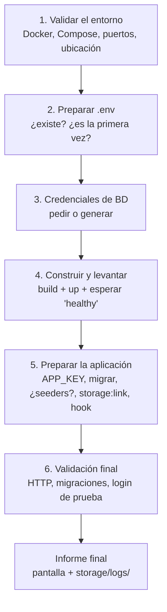

# Despliegue automatizado (`desplegar.sh`)

Script en la raíz del repositorio que encadena, con validación en cada paso, lo mismo
que ya describe [`00-entorno.md`](00-entorno.md): comprobar que la máquina tiene lo
necesario, levantar los cinco servicios, dejar la base de datos lista y confirmar al
final que la aplicación responde y que se puede iniciar sesión.

**No reemplaza nada.** `make up`, `make migrate`, `make hooks`, etc. siguen
funcionando sueltos para el día a día; este script es para el momento puntual de
poner el proyecto a andar en una máquina —la primera vez, o después de un cambio
grande— sin tener que acordarse del orden exacto de una checklist.

## Cómo se ejecuta

```bash
./desplegar.sh
```

Desde la raíz del repositorio (donde vive `docker-compose.yml`). Si se ejecuta desde
otro sitio, lo primero que hace es avisar y salir, no un error de Docker a medias.

Es interactivo cuando corre en una terminal real: pide las contraseñas de la base de
datos y pregunta si cargar datos de ejemplo. Si no hay terminal (por ejemplo, lanzado
desde un `cron`, un pipe, o una herramienta de CI), no se queda esperando una
respuesta que nadie va a escribir: genera las contraseñas solas y no carga datos de
ejemplo, dejando todo anotado en el informe final.

## Las seis fases



### Fase 1 — Validar el entorno

Antes de tocar nada, comprueba que exista lo necesario para no fallar a medias:

| Comprobación | Si falla |
|---|---|
| Se ejecuta desde la raíz del repo | Aborta con la ruta exacta donde se ejecutó |
| `docker` instalado | Aborta, pide instalar Docker Engine |
| El demonio de Docker responde | Aborta; si es un problema de permisos, lo dice explícitamente (grupo `docker` o `sudo`) |
| `docker compose` (plugin v2) disponible | Aborta; el binario viejo `docker-compose` (v1, con guion) no sirve |
| `curl` instalado | Aborta (hace falta para la validación final) |
| `make` instalado | Solo advierte: no es necesario para este script, pero sí para el resto del flujo del proyecto |
| `.env.example` presente | Aborta: sin él no hay valores de partida |
| Puertos 8080, 3309 y 5173 libres | Advierte si están ocupados por este mismo proyecto ya corriendo; **falla** si los ocupa algo ajeno |

Cualquier fallo aquí detiene el script antes de construir o levantar nada.

### Fase 2 — `.env` y primera ejecución

Si no existe `.env`, lo crea desde `.env.example`. Determina si es la **primera vez**
mirando dos señales: que `.env` no existiera, o que exista pero `APP_KEY` esté vacía
(un entorno a medio configurar cuenta como "primera vez" también). Esta bandera decide
más adelante si se pregunta por datos de ejemplo.

Ajusta además `UID`/`GID` en `.env` con los del usuario actual del host —no es un
dato sensible, no se pregunta, simplemente se corrige— para que lo que los
contenedores escriban en el código no quede como `root`.

### Fase 3 — Credenciales de la base de datos

Pide `DB_PASSWORD` (la de la aplicación) y `DB_ROOT_PASSWORD` (la de administración
de MySQL) por separado. **Por qué son dos contraseñas distintas** y no una sola: ver
la última sección de este documento.

Reglas:

- Si `.env` ya trae un valor para alguna de las dos, **no se vuelve a preguntar**: se
  conserva. Esto es intencional y no un descuido — la contraseña de un volumen de
  MySQL ya existente no cambia por editar `.env` después, así que volver a preguntar
  no serviría de nada y solo generaría confusión.
- La entrada no se muestra en pantalla mientras se escribe, y se pide dos veces para
  confirmar (hasta 3 intentos).
- Enter vacío genera una contraseña aleatoria de 24 caracteres y la muestra una única
  vez en pantalla. Se guarda en `.env`; para volver a verla más tarde:
  `grep DB_ .env`.
- Si detecta que ya existe un volumen `datos-mysql` de una instalación anterior **y**
  la contraseña en `.env` está vacía, avisa explícitamente: si esa base ya tiene datos
  reales, hay que escribir la contraseña **original**, no generar una nueva, o la
  aplicación no podrá conectarse.

### Fase 4 — Construir y levantar

`docker compose build`, `docker compose up -d`, y luego **`composer install`** dentro
del contenedor `app` antes de esperar a que los servicios queden sanos. Este paso
existe porque el `Dockerfile` instala el binario de Composer pero no las dependencias
del proyecto: en un clon recién hecho, sin `vendor/`, tanto `worker` como `node`
entran en bucle de reinicio (el primero porque `queue:work` no arranca sin
`vendor/autoload.php`; el segundo porque el plugin de Wayfinder de Vite invoca
`php artisan wayfinder:generate`, que tampoco arranca). Tras instalar las
dependencias, reinicia `node` y `worker` explícitamente en vez de esperar a que
Docker los reintente solo.

Después espera hasta 2 minutos a que los cinco servicios (`app`, `nginx`, `mysql`,
`node`, `worker`) reporten `healthy`.

### Fase 5 — Preparar la aplicación

1. Genera `APP_KEY` si sigue vacía.
2. Migraciones:
   - **Primera vez**: pregunta si cargar datos de ejemplo (clientes, proyectos,
     usuarios de prueba). Sí → `migrate --seed`. No, o sin terminal interactiva →
     solo `migrate`.
   - **Entorno ya inicializado**: solo `migrate`, para aplicar lo pendiente sin tocar
     los datos existentes. Nunca corre `migrate:fresh` ni nada destructivo.
3. `storage:link`. Si el enlace ya existía, Laravel lo informa y no se trata como
   error.
4. Instala el hook de `pre-commit` (formato con Pint) en `.git/hooks/`, si el
   directorio `.git` existe.

### Fase 6 — Validación final

No basta con que los contenedores estén sanos; comprueba que la aplicación responde
de verdad:

| Comprobación | Cómo |
|---|---|
| Los cinco servicios siguen `healthy` | `docker compose ps` |
| La aplicación responde | `curl` contra `/up` (la ruta de salud de Laravel), en el puerto real que Compose publicó |
| No quedan migraciones pendientes | `artisan migrate:status` |
| Se puede iniciar sesión | Intenta autenticar al usuario de prueba (`admin@gestor.test`) con `Auth::once()`, sin dejar sesión abierta |

La comprobación de login es **best effort**, no un error automático si falla: si no
se cargaron datos de ejemplo en este despliegue (una decisión válida, sobre todo si
es un entorno donde no se quieren datos ficticios), no hay ningún usuario de prueba
conocido y el script lo señala como advertencia, no como fallo.

## El informe final

Se imprime en pantalla y se guarda, siempre, en
`storage/logs/despliegue_<fecha>_<hora>.log` (esa carpeta ya está fuera de Git). Cada
paso queda como `[OK]`, `[ADVERTENCIA]` o `[ERROR]`, con el detalle exacto capturado
—incluida la salida completa del comando que falló, no solo "algo salió mal"— para
que quien lo revise después no tenga que reproducir el fallo para entenderlo.

El script termina con código de salida `0` si no hubo errores (las advertencias no
cuentan) y `1` si hubo al menos uno.

## Si algo falla

El script se detiene en el primer error de un paso del que no tiene sentido seguir
(por ejemplo, si `docker compose build` falla, no tiene caso intentar levantar nada).
Lee el detalle que imprime — es la salida real del comando que falló, no un resumen — 
corrige lo que señale, y **vuelve a ejecutar el script**. Es seguro repetirlo cuantas
veces haga falta: cada fase detecta lo que ya está hecho y no lo repite ni lo destruye
(las contraseñas ya puestas no se vuelven a pedir, las migraciones ya aplicadas no se
tocan, un `storage:link` ya existente no cuenta como error).

## Casos de uso

| Situación | Qué pasa |
|---|---|
| Primera instalación en una máquina nueva | Todo el flujo completo: crea `.env`, pide contraseñas, pregunta por datos de ejemplo |
| Reinstalación sobre una base de datos con datos reales (volumen `datos-mysql` existente, `.env` perdido) | Avisa explícitamente antes de pedir contraseñas: hay que poner la original, no generar una nueva |
| Entorno ya funcionando, solo aplicar cambios (`git pull` con migraciones nuevas) | No pregunta nada, no toca datos existentes; solo migra lo pendiente y reinstala dependencias si cambiaron |
| Entorno de ejemplo o de pruebas para un tercero | Responder "sí" a los datos de ejemplo en la Fase 5 |
| Entorno sin datos de ejemplo (más cercano a producción) | Responder "no"; la validación de login queda como advertencia, no como error |
| Ejecución sin terminal (`cron`, CI) | No pregunta nada: genera contraseñas solas y no carga datos de ejemplo |

## Limitaciones conocidas

- Los puertos que valida (8080, 3309, 5173) están fijos en el script, tomados de los
  que documenta `00-entorno.md`. Si el proyecto se reconfigura para usar otros, hay
  que actualizar el arreglo `PUERTOS_ESPERADOS` al principio del archivo.
- No hace respaldo de nada antes de migrar. Para eso está `make respaldo` — si vas a
  desplegar sobre una base con datos reales, hazlo antes.
- No gestiona servidores remotos ni SSH: se ejecuta en la misma máquina donde van a
  vivir los contenedores.

## Por qué la base de datos y `root` tienen contraseñas distintas

MySQL, dentro del contenedor, no tiene un solo usuario: tiene al menos dos con roles
completamente distintos.

- **`root`** es el superusuario del servidor de MySQL entero: puede crear o borrar
  cualquier base de datos, crear otros usuarios, cambiar la configuración del
  servidor. No tiene ningún límite.
- **`gestor`** (el que usa la aplicación, vía `DB_USERNAME`/`DB_PASSWORD`) es un
  usuario de aplicación: la imagen oficial de MySQL lo crea con privilegios
  **únicamente sobre la base `gestor_tareas`**, nada más.

Laravel se conecta siempre como `gestor`, nunca como `root`. Es el principio de
mínimo privilegio: si algún día hay un error en la aplicación (una inyección SQL, una
consulta mal construida, lo que sea), el daño posible queda acotado a una sola base
de datos, no al servidor completo. La contraseña de `root` solo la usan las tareas
administrativas que de verdad necesitan acceso total —en este proyecto,
`make respaldo`/`make restaurar`, que vuelcan y restauran la base **entera**, no solo
lo que `gestor` puede ver—.

Que sean distintas es, además, una capa de contención: si `.env` se filtrara alguna
vez, quien lo tenga solo obtiene acceso a una base de datos, no al servidor de MySQL
completo.
