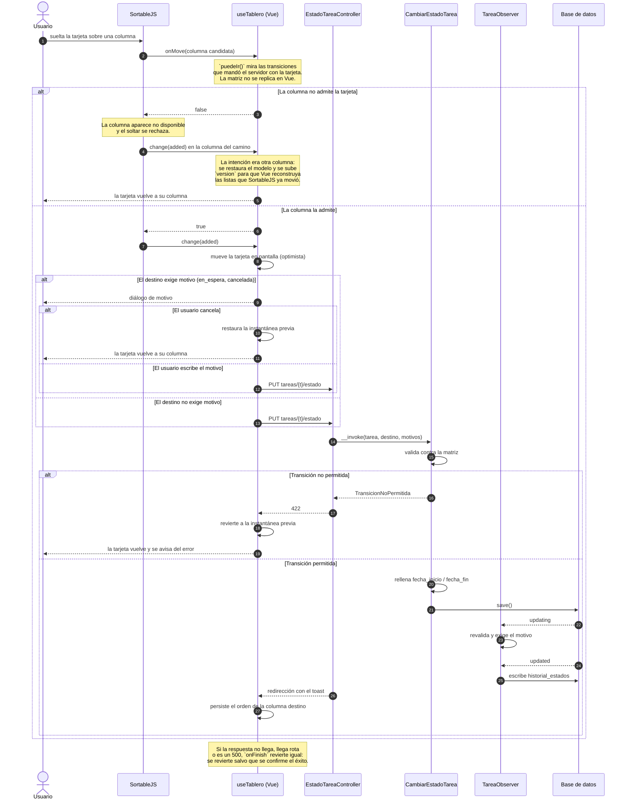

# Arrastrar una tarjeta en el tablero

Desde que se suelta la tarjeta hasta que queda fila en el historial, **incluido el camino
de vuelta**. Es el recorrido del tablero agrupado **por estado**, que es el único en el
que soltar una tarjeta cambia el estado de una tarea.

Agrupado por módulo o por prioridad el recorrido es otro y mucho más corto: un `update`
de un campo por `MoverTareaEnTableroController`, sin matriz, sin motivo y sin historial.
Agrupado por tipo no hay recorrido: el tipo se fija al crear y no cambia.

## Las tres cosas que este diagrama existe para dejar claras

1. **La matriz solo vive en el servidor.** La interfaz pregunta con
   `puedeIr()`, y lo que responde son las transiciones que el servidor mandó con cada
   tarjeta. Replicarla en Vue sería una cuarta fuente de verdad —enum, skill, diagrama y
   cliente— y la única que ninguna prueba comprueba.

2. **Hay tres caminos de vuelta, no uno.** El soltar rechazado, el diálogo cancelado y el
   error del servidor son tres momentos distintos en los que la tarjeta tiene que volver a
   su sitio. Una tarjeta que se queda donde el usuario la soltó mientras el servidor dice
   que no es peor que no tener arrastre, porque miente sobre lo que hay guardado.

3. **El historial no lo escribe el servicio, lo escribe el observer.** Si dependiera de
   que alguien llame al servicio, algún día habría un camino que no lo llama —una acción
   masiva, un comando— y quedaría un hueco silencioso.
