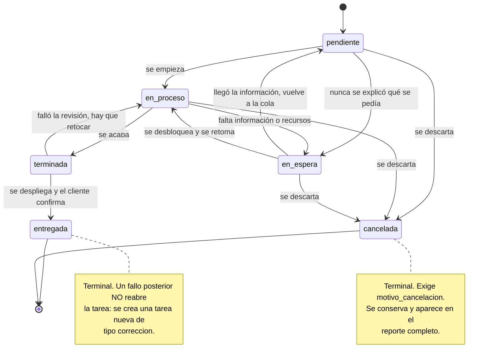

# Ciclo de vida de una tarea

> Este diagrama, la matriz de la skill `estados-de-tarea` y
> `EstadoTarea::transicionesPermitidas()` **deben coincidir exactamente**. Si divergen,
> hay un bug esperando: alguno de los tres está mintiendo sobre lo que el código
> permite. `tests/Unit/MatrizDeTransicionesTest.php` compara los tres en cada corrida.

## Diagrama de estados

## Matriz de transiciones

Filas = estado actual. Columnas = estado destino. `✔` = permitida, `✘` = prohibida,
`—` = el mismo estado (no es una transición).

| Desde ↓ / Hacia → | pendiente | en_proceso | en_espera | terminada | entregada | cancelada |
|---|---|---|---|---|---|---|
| **pendiente** | — | ✔ | ✔ | ✘ | ✘ | ✔ |
| **en_proceso** | ✘ | — | ✔ | ✔ | ✘ | ✔ |
| **en_espera** | ✔ | ✔ | — | ✘ | ✘ | ✔ |
| **terminada** | ✘ | ✔ | ✘ | — | ✔ | ✘ |
| **entregada** | ✘ | ✘ | ✘ | ✘ | — | ✘ |
| **cancelada** | ✘ | ✘ | ✘ | ✘ | ✘ | — |

Once transiciones válidas.

## Notas

- **`en_espera` significa exclusivamente falta de información o de recursos** para
  entender o ejecutar la tarea. No cubre esperas de despliegue: al llegar a `terminada`
  el commit ya está en la nube y bajarlo al servidor es trámite, no bloqueo. Por eso
  **no existe `terminada → en_espera`**.
- **`en_espera` se alcanza también desde `pendiente`**: una tarea puede estar bloqueada
  sin haberse empezado porque el cliente nunca explicó qué quería.
- **`en_espera → pendiente` existe**: llegó la información y la tarea vuelve a la cola
  sin haberse empezado.
- **`terminada` no se cancela.** Lo que ya está hecho se entrega, o se abre una tarea
  nueva que lo revierta; borrar el rastro del trabajo hecho falsea el periodo.
- Pasar a `en_espera` exige `motivo_espera`; pasar a `cancelada` exige
  `motivo_cancelacion`. Son **campos distintos**, no se reutilizan entre sí.
- Una transición de un estado a sí mismo no es una transición y no se registra.
- Todo cambio lo registra `TareaObserver`, nunca el controlador: valida en `updating` y
  escribe el historial en `updated`, cuando el UPDATE ya se ejecutó.

## Los tres ejes son independientes

Este diagrama describe **solo el estado**. El **tipo** (`desarrollo`, `correccion`,
`soporte`, `mejora`, `investigacion`) no cambia nunca, y la **prioridad** (`baja`,
`media`, `alta`, `critica`) cambia libremente sin restricciones de transición.

"Corrección" y "Soporte" son **tipos**: recorren este mismo ciclo completo.
