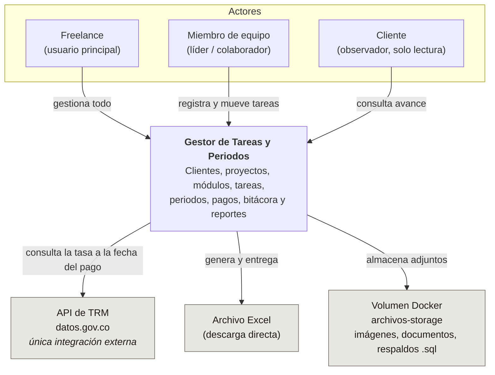

# Diagrama de contexto

Qué hace el sistema, quién lo usa y con qué se comunica hacia fuera.

## Contexto

## Alcance

El sistema resuelve cuatro necesidades:

1. **Registrar y mover tareas** por su ciclo de vida, agrupadas por proyecto y módulo.
2. **Cerrar periodos** y registrar el pago recibido, con la tasa de cambio del día.
3. **Generar reportes Excel** con trazabilidad de qué se emitió y con qué contenido.
4. **Guardar contexto**: bitácora de reuniones e imágenes, documentos y respaldos de
   base de datos por proyecto.

## Integraciones externas

**Una sola**: la API de TRM de `datos.gov.co`, que devuelve la tasa representativa del
mercado peso/dólar.

Dos detalles que la definen:

- Se consulta **a la fecha del pago**, no a la fecha de hoy. Registrar un pago de marzo
  en abril debe usar la TRM de marzo.
- El valor obtenido queda **siempre editable a mano**. La API puede fallar, no tener el
  dato de esa fecha, o el cobro real puede haberse liquidado a otra tasa.

No hay pasarela de pago, ni envío de correo al cliente, ni sincronización con
repositorios. El reporte se descarga y se entrega por el canal que el usuario prefiera.

## Despliegue

Corre **en local, sobre Linux, con Docker**. No hay entorno de producción.
Ver [`../00-entorno.md`](../00-entorno.md).
