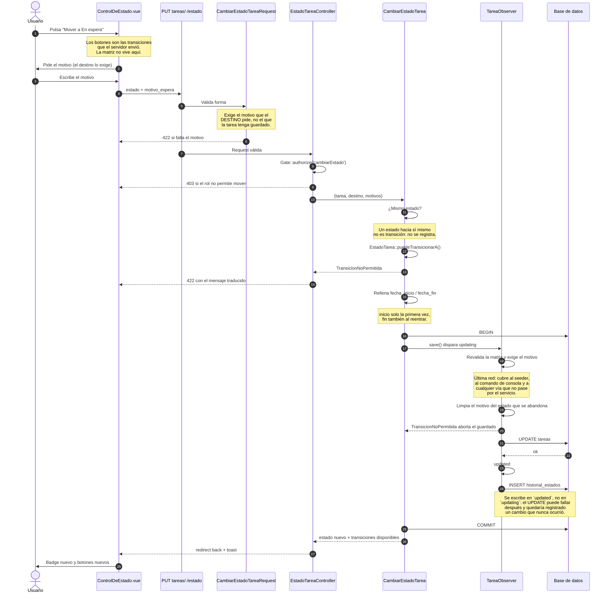

# Flujo: cambio de estado de una tarea

Desde el clic hasta el registro en el historial. Escrito en la **fase 06**.

Lo que este diagrama existe para dejar claro es **dónde valida cada pieza y dónde
escribe**, porque a primera vista parece que el servicio y el observer hacen lo mismo.

## Quién hace qué

| Pieza | Valida | Escribe |
|---|---|---|
| `ControlDeEstado.vue` | Nada. Solo ofrece lo que recibió | Nada |
| `CambiarEstadoTareaRequest` | Forma: enum válido y motivo del destino | Nada |
| `EstadoTareaController` | Autorización (`cambiarEstado`) | Nada |
| `CambiarEstadoTarea` | La matriz, antes de tocar la base | `estado`, `fecha_inicio`, `fecha_fin`, motivos |
| `TareaObserver@updating` | La matriz otra vez, y el motivo | Limpia el motivo abandonado |
| `TareaObserver@updated` | Nada | `historial_estados` |

## Por qué el servicio y el observer validan lo mismo

No es duplicación, es **profundidad**:

- El **servicio** valida para que el usuario reciba un 422 legible sin que se abra
  ninguna transacción ni se toque una fila.
- El **observer** valida para que un seeder, un comando de consola o una acción masiva
  —que no pasan por el servicio— tampoco puedan escribir una transición prohibida.

Si solo estuviera el servicio, el día que alguien escriba
`$tarea->update(['estado' => 'entregada'])` en un comando, la matriz dejaría de existir en
silencio. Si solo estuviera el observer, el usuario recibiría un 500 en lugar de un
mensaje, y las fechas automáticas no se rellenarían.

## Por qué el historial no lo escribe el servicio

Porque entonces dependería de que alguien llame al servicio. El historial es el registro
que responde "¿quién movió esto y por qué?" meses después, y un hueco silencioso en él no
se detecta hasta que hace falta. En `updated` se escribe **siempre que el UPDATE haya
ocurrido de verdad**, venga de donde venga.
