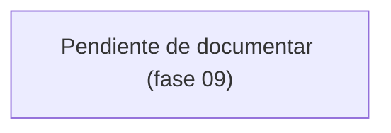

# Flujo de cierre de periodo

> **Pendiente.** Este diagrama se escribe en la **fase 09**.

Recorrido de cerrar un periodo: arrastre de tareas no terminadas, registro del pago, consulta de la TRM a la fecha del pago y cálculo del monto en COP.

