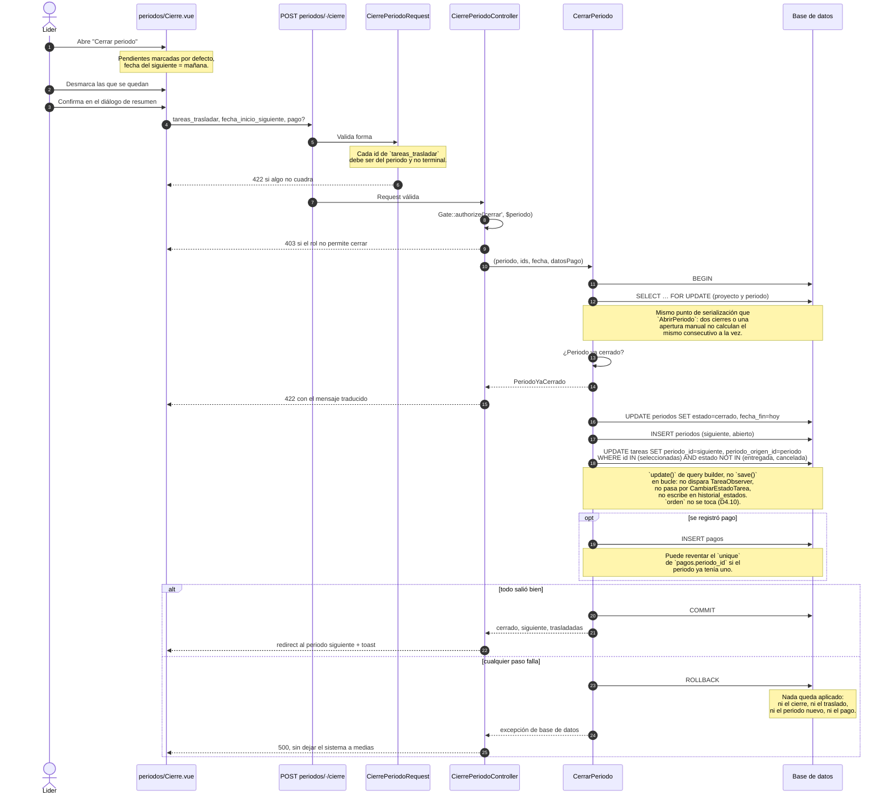

# Flujo: cierre de un periodo

Desde que el líder abre la pantalla de cierre hasta que el periodo siguiente queda
abierto. Escrito en la **fase 09**.

Lo que este diagrama existe para dejar claro es que **las cuatro cosas que ocurren al
cerrar —cerrar el periodo, trasladar lo seleccionado, abrir el siguiente y registrar el
pago— pasan dentro de una sola transacción**, y qué queda en pie cuando una de ellas
falla a mitad de camino.

## Quién hace qué

| Pieza | Valida | Escribe |
|---|---|---|
| `periodos/Cierre.vue` | Nada. Ofrece las tareas no terminales que el servidor envió | Nada |
| `CierrePeriodoRequest` | Forma: cada id pertenece al periodo y no es terminal | Nada |
| `CierrePeriodoController` | Autorización (`cerrar`) | Nada |
| `CerrarPeriodo` | Que el periodo siga `abierto`, dentro de la transacción | `periodos` (cierra y abre), `tareas` (traslada), `pagos` (si se registró) |

## El camino de reversión

Tres formas de que la transacción no llegue a `COMMIT`, y qué pasa en cada una:

1. **El periodo ya estaba cerrado** (alguien lo cerró en otra pestaña entre que se abrió
   la pantalla y se confirmó). `CerrarPeriodo` lo comprueba **después** de bloquear la
   fila con `lockForUpdate()`, así que la segunda petición espera a la primera y ve el
   estado real, no el que tenía cuando cargó la pantalla. Se lanza `PeriodoYaCerrado`
   antes de escribir nada: no hay nada que deshacer.
2. **El pago viola el `unique` de `periodo_id`** (mismo caso: un pago se registró por
   otra vía mientras la pantalla estaba abierta). Para entonces la transacción ya cerró
   el periodo, trasladó las tareas y abrió el siguiente — y el `ROLLBACK` los deshace a
   los tres. Es el escenario que prueba
   `tests/Feature/Periodos/CierrePeriodoTest.php` forzando exactamente esta colisión.
3. **Cualquier otra excepción de base de datos** durante el `INSERT` o el `UPDATE`
   masivo. El resultado es el mismo: `DB::transaction()` hace `ROLLBACK` automático en
   cuanto la clausura lanza, y ni el periodo, ni las tareas, ni el pago quedan a medio
   escribir.

Un cierre a medias —periodo cerrado sin que las tareas se movieran, o tareas movidas sin
que el periodo nuevo exista— es el peor estado posible del sistema: rompe la cuenta de
"cuántas tareas tiene cada periodo" y dificulta razonar sobre qué facturar. Por eso las
cuatro escrituras viven en una sola transacción y no en cuatro peticiones seguidas.
