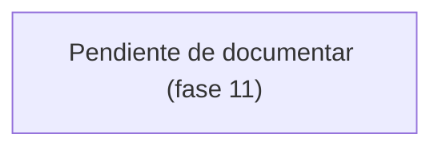

# Flujo de generación de reporte

> **Pendiente.** Este diagrama se escribe en la **fase 11**.

Recorrido de generar los dos reportes Excel (completo y de cliente), con el registro de trazabilidad que deja cada emisión.

