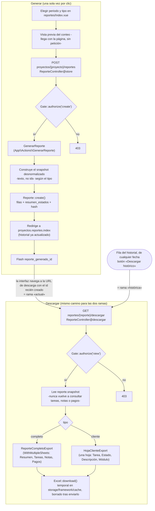

# Flujo de generación de reporte

Recorrido de generar los dos reportes Excel (completo y de cliente), con el registro de
trazabilidad que deja cada emisión y las dos ramas de descarga -actual e histórica- que
convergen en el mismo código.

Detalle en [`../modulos/reportes.md`](../modulos/reportes.md).

Las dos ramas de descarga —el primer clic tras generar y un registro histórico
cualquiera— entran por el mismo `ReporteController@descargar`, que **siempre** lee del
`snapshot` y nunca de una consulta en vivo. No hay una generación de archivo distinta
para cada una: «actual» es, literalmente, leer el snapshot que se acaba de escribir.
