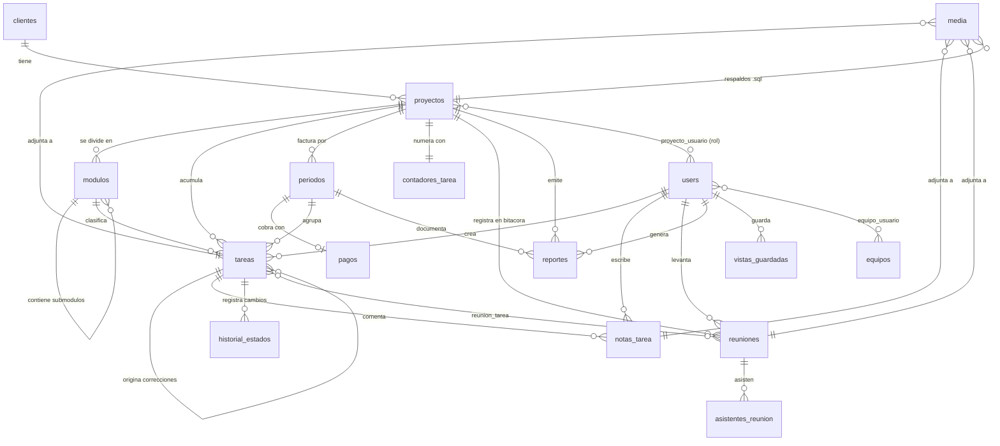

# Modelo entidad-relación

Diecisiete tablas de dominio, más `users` (que Laravel impone) y `media` (de
Medialibrary). El diccionario de datos completo está en
[`../02-modelo-de-datos.md`](../02-modelo-de-datos.md).

## Diagrama

## Cómo leerlo

- **`periodos ||--o| pagos`** es uno a *cero o uno*, no uno a muchos: el `unique` en
  `pagos.periodo_id` es lo que hace real la regla "un periodo, un pago".
- **`proyectos ||--|| contadores_tarea`** es uno a uno estricto: cada proyecto nace con
  su contador en cero, creado por `ProyectoObserver`.
- **`modulos ||--o{ modulos`** es la autoreferencia: un módulo puede contener
  submódulos sin límite de profundidad.
- **`tareas` se apunta a sí misma** por `tarea_origen_id` (`set null`): una tarea de tipo
  `correccion` o `soporte` señala la entrega que la originó. Borrar la entrega no borra la
  corrección, que es trabajo hecho y cuenta en su periodo.
- **`tareas` apunta dos veces a `periodos`**: `periodo_id` es el periodo actual y
  `periodo_origen_id` el periodo del que se arrastró, si se arrastró.
- **`media` es polimórfica.** La misma tabla guarda imágenes y documentos de tareas,
  notas y reuniones, y los respaldos `.sql` de un proyecto. Lo que separa unos de
  otros es `collection_name`, y los respaldos van además en **disco privado**.

## Comportamiento al borrar

| Al borrar | Pasa esto |
|---|---|
| Un **cliente** con proyectos | **Se impide** (`restrict`). Borrar un cliente vivo es un accidente, no una operación. |
| Un **proyecto** | Borrado suave. Un `forceDelete` arrastra módulos, periodos, tareas, reuniones, reportes y el contador. |
| Un **módulo** | Sus submódulos caen con él; **sus tareas sobreviven** con `modulo_id` nulo. |
| Un **periodo** | Sus tareas sobreviven con `periodo_id` nulo; el pago cae con él. |
| Una **tarea** | Borrado suave. Un `forceDelete` arrastra notas e historial. |
| Un **usuario** que creó tareas, notas, reuniones o reportes | **Se impide** (`restrict`): esos registros dicen quién hizo qué. |
| Un **usuario** que asistió a una reunión | El asistente queda con `usuario_id` nulo y **conserva el nombre escrito**. |
