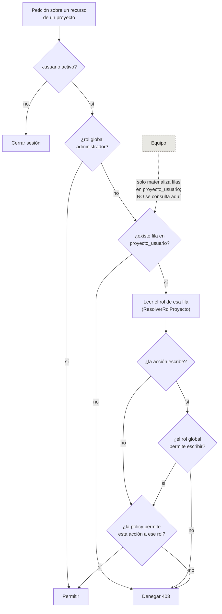

# Permisos y roles

> El rol se resuelve **desde el pivote `proyecto_usuario`**, nunca desde el equipo. El
> equipo es solo un atajo de asignación masiva. Ver la regla del glob `app/Policies/**`.

## Dos niveles

La autorización tiene **dos capas**, y confundirlas es el error clásico.

### Rol global — el techo

Respaldado por `spatie/laravel-permission`. Enum `RolGlobal`.

| Rol global | Alcance |
|---|---|
| `administrador` | Todo. Crea clientes, proyectos y usuarios |
| `miembro` | Trabaja en los proyectos donde esté asignado. No crea clientes ni usuarios |
| `invitado` | **Solo lectura**, y solo donde esté asignado. Es el rol de la gente del cliente |

### Rol de proyecto — el alcance

Pivote `proyecto_usuario`. Enum `RolProyecto`.

| Rol de proyecto | Alcance |
|---|---|
| `lider` | Todo dentro del proyecto: módulos, periodos, pagos, cierre |
| `colaborador` | Crea y mueve tareas, escribe notas y reuniones. No toca periodos ni pagos |
| `observador` | Lee todo lo interno. No escribe |
| `cliente` | Lee solo lo marcado `visibilidad = cliente`. **Nunca ve pagos** |

### La regla que las une

**Gana siempre el más restrictivo.** El rol global acota el techo; el de proyecto acota el
alcance.

Un `invitado` global con rol de proyecto `lider` **sigue siendo de solo lectura**. Es lo
que evita el agujero: si alguien asigna por error el rol de proyecto equivocado a una
persona del cliente, el rol global la contiene.

## Resolución del permiso efectivo

Resolver el rol desde el equipo produce **escalada de privilegios silenciosa**: alguien
cambia de equipo y gana acceso a proyectos que nadie le concedió.

## Matriz rol de proyecto × recurso × acción

Suponiendo un rol global que no restrinja (`administrador` o `miembro`). Con `invitado`
global, **toda la columna de escritura pasa a denegada**, sea cual sea el rol de proyecto.

`✔` permitido · `·` denegado · `L` solo lectura

| Recurso | Acción | Líder | Colaborador | Observador | Cliente |
|---|---|---|---|---|---|
| **Proyectos** | ver | ✔ | ✔ | L | L |
| | editar | ✔ | · | · | · |
| | crear / eliminar | · | · | · | · |
| | gestionar miembros | ✔ | · | · | · |
| **Módulos** | ver | ✔ | ✔ | L | L |
| | crear / editar / eliminar | ✔ | · | · | · |
| **Tareas** | ver | ✔ | ✔ | L | L |
| | crear / editar | ✔ | ✔ | · | **·** |
| | cambiar estado | ✔ | ✔ | · | **·** |
| | eliminar | ✔ | · | · | · |
| **Periodos** | ver | ✔ | ✔ | L | L |
| | crear / editar / **cerrar** | ✔ | · | · | · |
| **Pagos** | ver | ✔ | · | L | **·** |
| | crear / editar / eliminar | ✔ | · | · | **·** |
| **Bitácora** | ver reunión compartida | ✔ | ✔ | L | L |
| | ver reunión **interna** | ✔ | ✔ | L | **·** |
| | crear / editar | ✔ | ✔ | · | · |
| | eliminar | ✔ | · | · | · |
| **Notas de tarea** | ver nota compartida | ✔ | ✔ | L | L |
| | ver nota **interna** | ✔ | ✔ | L | **·** |
| | crear | ✔ | ✔ | · | · |
| **Archivos** | ver adjunto de algo compartido | ✔ | ✔ | L | L |
| | ver adjunto **interno** | ✔ | ✔ | L | **·** |
| | descargar **respaldo `.sql`** | ✔ | **·** | **·** | **·** |
| **Reportes** | ver | ✔ | ✔ | L | **·** |
| | generar | ✔ | ✔ | · | **·** |

> `pagos.ver` es un permiso distinto de `pagos.registrar`: un observador interno puede
> necesitar ver los pagos sin poder crearlos.

> **Generar un reporte cuenta como escritura**, no como lectura: deja una fila en
> `reportes` con el snapshot de lo exportado. Por eso el observador puede ver los
> reportes emitidos pero no emitir uno nuevo.

### Recursos que no cuelgan de un proyecto

Clientes, equipos y usuarios no tienen rol de proyecto que consultar: los gobierna el rol
global.

| Recurso | Acción | `administrador` | `miembro` | `invitado` |
|---|---|---|---|---|
| **Clientes** | ver | ✔ | ✔ | · |
| | crear / editar / eliminar | ✔ | · | · |
| **Equipos** | ver / gestionar | ✔ | · | · |
| **Usuarios** | ver / gestionar | ✔ | · | · |

## Qué NO ve el cliente

Las exclusiones que definen el rol. Están en negrita en la matriz:

1. **Pagos.** Ni el monto en USD, ni la TRM, ni el monto en COP. Tampoco el reporte
   completo, que los contiene, ni la acción de generarlo.
2. **Reuniones y notas internas.** Contienen estimaciones, notas sobre el propio cliente y
   decisiones aún no comunicadas.
3. **Respaldos `.sql`.** Viven en **disco privado** y solo los alcanza `lider` o
   `administrador` — ni siquiera un colaborador interno, porque un dump lleva la base
   entera.

> Estas exclusiones se aplican **en la consulta**, no ocultando columnas en la interfaz.
> Un cliente no debe poder alcanzar el dato ni por la API, ni por un filtro, ni por un
> `include` de relaciones. Ocultarlo solo en el frontend es una filtración esperando a que
> alguien abra las DevTools.

Y se aplican **dos veces**: la policy cubre el acceso por id, y el scope
`visiblesPara()` cubre los listados. Solo con la policy, un listado devolvería los
títulos de las reuniones internas aunque el detalle diera 403.
