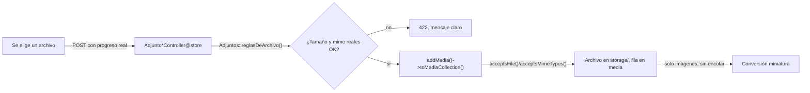

# Módulo: Archivos

## Propósito

Un sitio seguro donde guardar imágenes, documentos y respaldos de base de datos por
proyecto. "Seguro" tiene dos partes: ningún archivo se sirve por una URL que no
pregunte quién lo abre, y ningún archivo se acepta por lo que dice ser en su nombre —
solo por lo que de verdad es.

## Modelo de datos

No hay tabla propia: los adjuntos son la tabla `media` de
`spatie/laravel-medialibrary`, colgando de `Proyecto`, `Tarea` y `Reunion` (los tres
implementan `HasMedia`). Diccionario completo en
[`../02-modelo-de-datos.md`](../02-modelo-de-datos.md).

- **Tres colecciones**, con su límite, su disco y sus conversiones:

  | Colección | Límite | Disco | Conversiones |
  |---|---|---|---|
  | `imagenes` | 5 MB | público | Sí (`miniatura`, 320×320) |
  | `documentos` | 20 MB | público | No |
  | `respaldos_bd` | 256 MB | **privado** | No |

- **`respaldos_bd` solo cuelga de `Proyecto`.** `imagenes` y `documentos` cuelgan de
  `Tarea` y `Reunion`. `NotaTarea` implementa `HasMedia` desde una fase anterior pero
  esta fase no construye subida para notas: no tiene UI propia todavía.
- **Los límites y los tipos MIME reales viven en un solo sitio**, `App\Services\
  Adjuntos` (constantes `LIMITE_*` y `MIME_*`), leído a la vez por
  `acceptsFile()`/`acceptsMimeTypes()` de cada modelo y por
  `Adjuntos::reglasDeArchivo()`, que arma las reglas de validación de Laravel.
- **En la base de datos solo hay rutas y metadatos.** Los binarios viven en el volumen
  Docker `archivos-storage`. Un `docker compose down -v` los destruye; `down` a secas
  no.

## Reglas de negocio

1. **Ningún archivo se sirve por URL directa al disco.** Todo adjunto pasa por
   `archivos.descargar` (`ArchivoController`), que evalúa `MediaPolicy` antes de emitir
   un byte.
2. **`respaldos_bd` va a disco privado**, nunca al público, y solo la ve quien
   gestiona el proyecto (`lider` o `administrador`) — ni siquiera un `colaborador`
   interno, porque un dump lleva la base entera.
3. **El tipo se valida por contenido real, nunca por extensión.** La regla de
   validación es `mimetypes:`, que lee el archivo con `finfo`, no `mimes:`, que infiere
   por extensión. Un `.sql` que en realidad es un `.php` se rechaza aunque el nombre
   diga lo contrario.
4. **Solo `imagenes` lleva conversiones.** Un dump de 250 MB nunca pasa por
   procesamiento de imagen: `acceptsFile()`/`acceptsMimeTypes()` de `documentos` y
   `respaldos_bd` no registran ninguna, y `registerMediaConversions()` las limita a
   `performOnCollections('imagenes')`.
5. **Los límites de tamaño viven en cuatro sitios que cambian juntos**:
   `docker/php/php.ini`, `docker/nginx/default.conf`, las reglas de validación de
   Laravel y `acceptsFile()` de cada colección. Cambiar uno solo produce fallos
   silenciosos — ver la cadena de síntomas más abajo.
6. **Un adjunto hereda la visibilidad de su dueño.** Los de `Reunion` siguen la
   `visibilidad` de la reunión; los de `Tarea` y `Proyecto`, que no tienen marca
   propia, se tratan siempre como internos (`MediaPolicy::visibilidadDe()`) — un
   `cliente` no ve ninguno, ni en pantalla ni en el JSON de la página.

## Flujo principal

Subida de un archivo, desde el navegador hasta el disco:

## Rutas y controladores

| Método | URI | Controlador | Permiso requerido |
|---|---|---|---|
| GET | `archivos/{media}` | `ArchivoController@show` | `MediaPolicy@view` |
| POST | `proyectos/{p}/respaldos` | `RespaldoController@store` | `gestiona` |
| DELETE | `proyectos/{p}/respaldos/{media}` | `RespaldoController@destroy` | `gestiona` |
| POST | `tareas/{tarea}/adjuntos` | `AdjuntoTareaController@store` | escribe + `archivos.subir` |
| DELETE | `tareas/{tarea}/adjuntos/{media}` | `AdjuntoTareaController@destroy` | `MediaPolicy@delete` |
| POST | `reuniones/{reunion}/adjuntos` | `AdjuntoReunionController@store` | escribe + `archivos.subir` |
| DELETE | `reuniones/{reunion}/adjuntos/{media}` | `AdjuntoReunionController@destroy` | `MediaPolicy@delete` |

## Permisos

| Rol | Puede |
|---|---|
| Administrador | Todo, vía `Gate::before`. |
| Líder | Subir y borrar en las tres colecciones, incluida `respaldos_bd`. |
| Colaborador | Subir y borrar `imagenes`/`documentos` de tareas y reuniones. Nunca `respaldos_bd`. |
| Observador | Ver adjuntos internos, sin subir ni borrar. |
| Cliente | Ve solo los adjuntos de una reunión visible para él. Nunca ve `respaldos_bd` ni los de tarea/proyecto, que se tratan siempre como internos. |

## Decisiones de diseño

### La miniatura se sirve por la misma ruta, con `?conversion=miniatura`

**Alternativa descartada: una ruta `archivos/{media}/miniatura` aparte.** Se descartó
porque "ningún archivo se sirve por URL directa" es más fácil de sostener con **una**
puerta que con dos: `ArchivoController::show` acepta un parámetro de consulta
`conversion`, lo valida contra la única conversión que existe (`miniatura`, y solo si
`hasGeneratedConversion()` es verdad) y delega en `Media::toResponse($request,
$conversion)`, que ya sabe servir cualquiera de las dos.

### Límites y tipos MIME centralizados en `App\Services\Adjuntos`

Antes de esta fase, cada modelo declaraba su lista de MIME permitidos por separado.
Centralizarlos evita que "cambiar el límite de imágenes" signifique buscarlo en cuatro
sitios de PHP además de los dos de Docker: `Adjuntos::LIMITE_*` y `Adjuntos::MIME_*`
son la única fuente, y tanto `acceptsFile()`/`acceptsMimeTypes()` de los modelos como
`Adjuntos::reglasDeArchivo()` —usada por los tres controladores de subida— leen de ahí.

### `documentos` gana una lista de MIME que antes no tenía

Los modelos de fases anteriores registraban la colección `documentos` sin
`acceptsMimeTypes()`: aceptaba cualquier tipo. Esta fase le pone una lista (PDF, Word,
Excel, PowerPoint, texto plano, CSV, ZIP) porque "documentos, sin restricción" es
exactamente el hueco que permite subir un `.php` disfrazado a un disco público. La
regla D8's del dominio ("comprueba el mime real y rechaza lo que no corresponda a la
colección") no se sostiene con una colección que acepta cualquier cosa.

### La cadena de síntomas de los cuatro límites

Bajar cualquiera de los cuatro sitios sin bajar los demás no produce un error claro:

1. Si **Nginx** (`client_max_body_size`) es el más bajo, corta la petición **antes de
   que PHP la vea**: el usuario recibe un 413 y los logs de Laravel están vacíos.
2. Si **PHP** (`upload_max_filesize`/`post_max_size`) es el más bajo, descarta el
   cuerpo **antes de que corra la validación**: llega una request con `$_FILES` vacío
   y el error habla de un campo requerido, no de un tamaño.
3. Si la **validación de Laravel** (`Adjuntos::reglasDeArchivo()`) es la más baja,
   ahí sí aparece un 422 con el mensaje correcto — es el único de los cuatro que dice
   la verdad sobre qué pasó.
4. Si **Medialibrary** (`acceptsFile()`) es el más bajo, el archivo ya pasó la
   validación de Laravel y falla al guardarse con una excepción de servidor, no con un
   422 limpio.

Subir un archivo grande de verdad y medir en qué punto falla es la única forma de
confirmar los cuatro a la vez; ver el resultado real en el resumen de cierre de esta
fase.

## Puntos de extensión

- **Adjuntos en `NotaTarea`.** El modelo ya implementa `HasMedia` con las mismas
  colecciones que `Tarea`/`Reunion`; falta la UI y las rutas si una fase futura lo
  necesita.
- **Papelera de reciclaje para adjuntos borrados.** Hoy `MediaPolicy::delete()` borra
  de inmediato; si algún día hace falta poder deshacer, el punto de entrada es ahí.
