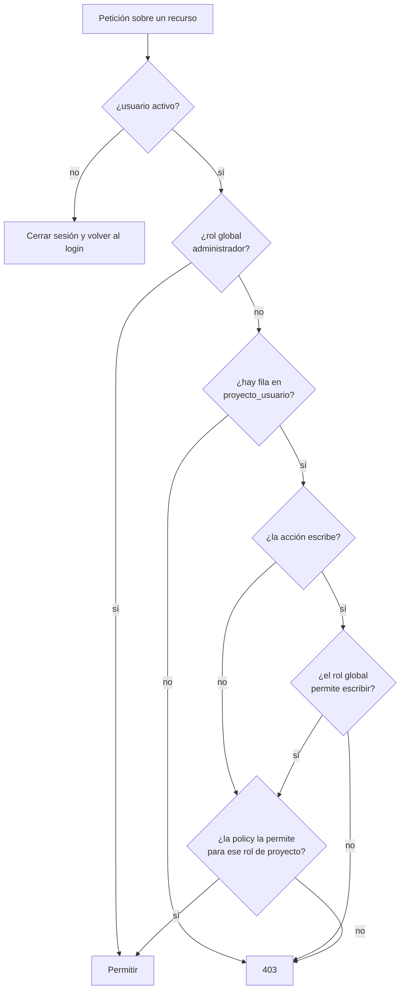

# Módulo: Autenticación y autorización

> Escrito en la **fase 04**. Cubre roles globales, roles de proyecto, policies,
> equipos y gestión de usuarios.

## Propósito

Decide quién entra y qué puede hacer una vez dentro. La pregunta que este módulo
responde no es "¿está autenticado?" sino "¿puede **esta persona** hacer **esto** en
**este proyecto**?".

Es también el módulo que sostiene la promesa del portal del cliente: alguien del cliente
entra, ve el avance de su proyecto y **no tiene forma de alcanzar un pago, una reunión
interna o un respaldo de la base**, ni por la interfaz ni escribiendo la URL a mano.

## Modelo de datos

Dos capas, en dos sitios distintos:

| Capa | Dónde vive | Qué decide |
|---|---|---|
| **Rol global** | `roles` / `model_has_roles` (`spatie/laravel-permission`), enum `RolGlobal` | El **techo**: qué puede hacer alguien en el sistema |
| **Rol de proyecto** | pivote `proyecto_usuario.rol`, enum `RolProyecto` | El **alcance**: qué puede hacer en ese proyecto concreto |

Más:

- **`users.activo`** (`boolean`, por defecto `true`) — un usuario se desactiva, nunca se
  borra: `tareas.creado_por` y `reuniones.creado_por` son `restrict`.
- **`permissions`** — los doce permisos del enum `Permiso`, con nomenclatura
  `recurso.accion`.
- **`equipos` / `equipo_usuario`** — agrupación de personas para asignarlas de golpe.
  **No otorga permisos.**

## Reglas de negocio

1. **El permiso efectivo se resuelve siempre desde el pivote `proyecto_usuario`**, nunca
   desde el equipo. Resolverlo desde el equipo produce escalada de privilegios
   silenciosa: alguien cambia de equipo y gana acceso a proyectos que nadie le concedió.
2. **Sin fila en el pivote no hay acceso al proyecto, ni de lectura.** La única excepción
   es el rol global `administrador`, y esa excepción vive en `Gate::before`.
3. **Un usuario tiene un solo rol por proyecto**, garantizado por el `unique` en
   `(proyecto_id, usuario_id)`.
4. **Gana siempre el más restrictivo.** El rol global acota el techo; el rol de proyecto
   acota el alcance. Un `invitado` global con rol de proyecto `lider` **sigue siendo de
   solo lectura**, y además **no ve nada interno**.
5. **La visibilidad se aplica en dos sitios**: la policy para el acceso por id y un
   **scope obligatorio** en los listados.
6. **Ningún archivo se sirve por URL directa al disco.** Todo adjunto pasa por
   `archivos.descargar`, que evalúa `MediaPolicy`.
7. **No hay registro público.** Las cuentas las crea el administrador.
8. **Un usuario desactivado no entra, y si tenía sesión abierta se le cierra.**
9. **El rol global `invitado` implica siempre `veLoInterno() === false`**, sea cual sea su
   rol de proyecto. Ser del cliente es una condición de la persona, no del proyecto.

### Por qué las reglas 4 y 9 existen

Tapan el agujero más probable de este sistema: que alguien, al dar de alta a una persona
del cliente en un proyecto, elija el rol de proyecto equivocado en el desplegable.
Sin ellas, ese error convierte a un cliente en líder. Con ella, el rol global
`invitado` lo contiene y el error se queda en un permiso de lectura de más, no en acceso
al dinero.

Funciona en los dos sentidos: un `miembro` global con rol de proyecto `cliente` tampoco ve
los pagos de ese proyecto.

La regla 9 es la mitad que faltaba, y llegó en la fase 05: el rol global no solo acota lo
que se **escribe**, también lo que se **lee**. Ver
[«El rol global `invitado` nunca ve lo interno»](#el-rol-global-invitado-nunca-ve-lo-interno-corregido-en-la-fase-05).

### El primer administrador: cómo se sale del huevo y la gallina

La regla 7 dice que las cuentas las crea el administrador, pero en una base recién
migrada no existe ninguno todavía. Dos piezas resuelven esto, añadidas fuera de fase
(mantenimiento post-fase-12, ver
[`docs/06-historial-de-decisiones.md`](../06-historial-de-decisiones.md)):

1. **Los roles y permisos ya existen sin sembrar nada aparte.** La migración
   `2026_09_04_140000_sembrar_roles_y_permisos` invoca `RolesYPermisosSeeder` desde su
   `up()`, así que el rol `administrador` (y `miembro`, `invitado`) existe en cuanto
   corre `php artisan migrate`, sin depender de `--seed` ni de que alguien se acuerde
   del nombre de la clase.
2. **`php artisan admin:crear`** (`app/Console/Commands/CrearAdministrador.php`) crea el
   usuario y le asigna el rol, sin pasar por el registro —que sigue deshabilitado—.
   Es idempotente por correo (`updateOrCreate`): correrlo de nuevo con uno que ya
   existe lo actualiza, incluso para promoverlo a administrador si tenía otro rol.

`desplegar.sh` lo ofrece de forma interactiva en la primera instalación; fuera de él,
`docker compose exec app php artisan admin:crear` pide nombre, correo y contraseña por
consola.

## Flujo principal

## Rutas y controladores

| Método | URI | Controlador | Autorización |
|---|---|---|---|
| GET | `usuarios` | `Gestion\UsuarioController@index` | `can:usuarios.gestionar` |
| GET | `usuarios/crear` | `Gestion\UsuarioController@create` | `can:usuarios.gestionar` |
| POST | `usuarios` | `Gestion\UsuarioController@store` | `can:usuarios.gestionar` |
| GET | `usuarios/{usuario}/editar` | `Gestion\UsuarioController@edit` | `can:usuarios.gestionar` |
| PUT | `usuarios/{usuario}` | `Gestion\UsuarioController@update` | `can:usuarios.gestionar` |
| PUT | `usuarios/{usuario}/estado` | `Gestion\EstadoUsuarioController@update` | `can:usuarios.gestionar` |
| GET/POST/PUT/DELETE | `equipos…` | `Gestion\EquipoController` | `EquipoPolicy` |
| POST/DELETE | `equipos/{equipo}/miembros…` | `Gestion\MiembroEquipoController` | `EquipoPolicy@update` |
| GET | `proyectos/{proyecto}/miembros` | `ProyectoUsuarioController@index` | `ProyectoPolicy@gestionarMiembros` |
| POST/PUT/DELETE | `proyectos/{proyecto}/miembros…` | `ProyectoUsuarioController` | `ProyectoPolicy@gestionarMiembros` |
| POST | `proyectos/{proyecto}/equipos` | `AsignarEquipoAProyectoController@store` | `ProyectoPolicy@gestionarMiembros` |
| GET | `archivos/{media}` | `ArchivoController@show` | `MediaPolicy@view` |

## Permisos

Matriz completa en
[`../diagramas/permisos-y-roles.md`](../diagramas/permisos-y-roles.md).

Los doce permisos (`Permiso`) se reparten así:

| Rol global | Permisos |
|---|---|
| `administrador` | Todos |
| `miembro` | Todos menos `clientes.crear` y `usuarios.gestionar` |
| `invitado` | Ninguno |

`pagos.ver` está separado de `pagos.registrar` a propósito: un observador interno puede
necesitar ver los pagos sin poder crearlos.

## Decisiones de diseño

### Dos capas en lugar de una

**Alternativa descartada: solo el rol de proyecto.** Es más simple y cubre el 95 % de los
casos, pero deja el sistema a merced de un desplegable: quien asigna a una persona del
cliente elige mal el rol y esa persona pasa a ver el dinero. El rol global es una segunda
llave que hay que girar aparte.

**Alternativa descartada: solo el rol global.** Entonces cualquier `miembro` puede tocar
cualquier proyecto, que es exactamente lo que un portal multicliente no puede permitir.

### El equipo no otorga permisos

**Es la confusión más probable de quien lea este código dentro de seis meses.** Un equipo
sirve para dar de alta a varias personas de golpe; al ejecutar la acción, las filas de
`proyecto_usuario` quedan **independientes**. Quitar a alguien del equipo **no** lo saca
del proyecto.

Es deliberado. Si el equipo fuera la fuente de verdad, mover a alguien de equipo
cambiaría en silencio sus permisos en proyectos que nadie revisó. Y la baja tampoco es
automática porque quitar acceso a un proyecto debe ser una decisión visible, no un efecto
colateral de reorganizar equipos.

La asignación **nunca sobrescribe** el rol de quien ya participaba: pudieron ascenderlo a
`lider` a propósito. La acción devuelve un resumen de agregados y omitidos.

### El rol global `invitado` nunca ve lo interno *(corregido en la fase 05)*

Hasta la fase 05, «ver lo interno» dependía **solo del rol de proyecto**:
`ResolverRolProyecto::veLoInterno()` preguntaba a `RolProyecto` y nada más. Eso dejaba un
agujero: un `invitado` global con rol de proyecto `lider` **leía las reuniones y las notas
internas**. No escribía —el rol global ya lo contenía—, pero leía.

Que no viera los pagos ocurría **de rebote**, porque `invitado` carece del permiso
`pagos.ver`. Una cerradura que funciona por casualidad no es una cerradura: bastaba con
conceder ese permiso a `invitado` por cualquier motivo para abrir el dinero entero.

La corrección tiene dos mitades, porque la visibilidad se aplica en dos sitios:

| Dónde | Qué cambió |
|---|---|
| `ResolverRolProyecto::veLoInterno()` | Exige que **las dos** capas digan que sí: `RolGlobal::veLoInterno()` y `RolProyecto::veLoInterno()` |
| `Reunion` y `NotaTarea`, `scopeVisiblesPara()` | Usan `proyectosSinAccesoInterno()` en lugar de `proyectosDondeEsCliente()` |

La segunda mitad es la que se olvida. `proyectosDondeEsCliente()` devolvía una lista
**vacía** para un `invitado` cuyo rol de proyecto no era `cliente` en ninguna parte, así
que ningún listado se le recortaba: el detalle daba 403 y el listado seguía enseñando los
títulos. `proyectosSinAccesoInterno()` responde la pregunta que los scopes hacen de
verdad —«¿en qué proyectos hay que recortar a este usuario?»— y para un `invitado` global
la respuesta son **todos** los suyos.

`tests/Feature/Autorizacion/InvitadoNoVeLoInternoTest.php` fija las tres combinaciones:
`invitado` + `lider` no ve reuniones internas ni en listado ni en detalle, `invitado` +
`colaborador` no ve notas internas, y `miembro` + `observador` **sí** las ve, porque es
interno aunque solo lea.

### La visibilidad se aplica dos veces

**Alternativa descartada: solo la policy.** La policy protege `GET /reuniones/{id}`, pero
no `GET /proyectos/{id}/reuniones`. Un listado sin filtrar devuelve los títulos de las
reuniones internas aunque el detalle dé 403, y *"Comité interno de márgenes"* ya es
información filtrada.

Por eso hay además `Reunion::scopeVisiblesPara()` y `NotaTarea::scopeVisiblesPara()`, y
son **obligatorios en todo listado**. `Tarea::scopeVisiblesPara()` hace lo propio con el
aislamiento por proyecto.

### Un servicio único de resolución

Las nueve policies que dependen de un proyecto llaman a `ResolverRolProyecto`. Repetir la
consulta al pivote en cada una garantiza que un día una quede desincronizada, y el que se
entera es el cliente. Una prueba comprueba que todas lo usan.

### `Gate::before` solo para el administrador

Cualquier otro atajo convierte las policies en decorado. Una prueba comprueba que solo
existe un `Gate::before` y que su condición es `esAdministrador()`.

### Desactivar en lugar de borrar

Borrar un usuario es imposible sin romper el historial (`creado_por` es `restrict`), y
además indeseable: el registro de quién hizo qué es parte del valor del sistema.

La desactivación se aplica en **dos puertas**: `Fortify::authenticateUsing` impide el
login por contraseña, y el middleware `AsegurarUsuarioActivo` cubre el resto —una
passkey, un "recuérdame", o una sesión que seguía abierta cuando lo desactivaron—.

## Puntos de extensión

- **Invitaciones por correo** (fase 12), si hace falta. El registro público seguiría
  apagado; lo que cambiaría es que la contraseña la pone el invitado.
- **Permisos por proyecto.** Hoy los permisos son globales y el rol de proyecto los
  recorta. Si un día hiciera falta "esta persona puede cerrar periodos solo en el
  proyecto X", el sitio es una columna extra en `proyecto_usuario`, no un rol nuevo.
- **Más roles de proyecto.** Añadir un caso a `RolProyecto` obliga a revisar
  `escribeTrabajo()`, `gestionaElProyecto()` y `veLoInterno()`: son los tres ejes que las
  policies consultan, y ninguna policy pregunta por el rol directamente.
- **Caché del rol resuelto.** `ResolverRolProyecto` consulta el pivote en cada
  comprobación. Es correcto y hoy barato; si una pantalla llega a hacer decenas de
  comprobaciones, ahí está el sitio para memorizar por petición.
