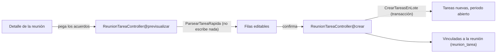

# Módulo: Bitácora

## Propósito

La bitácora es la memoria de contexto de un proyecto: qué se habló, con quién y qué
salió de ahí. Cada encuentro —reunión, llamada, correo o mensaje— queda como una
**reunión** con notas enriquecidas, sus asistentes y, opcionalmente, las tareas que
generó. Sin bitácora, "por qué se decidió esto" solo vive en la memoria de quien
estuvo presente.

## Modelo de datos

Tablas: **`reuniones`**, **`asistentes_reunion`** y el pivote **`reunion_tarea`**.
Diccionario completo en [`../02-modelo-de-datos.md`](../02-modelo-de-datos.md).

- **`contenido_json` es la fuente de verdad; `contenido_html` es una copia derivada**
  para mostrar y para el buscador. El editor (TipTap 3) produce los dos a la vez;
  `contenido_html` se sanea en el servidor antes de guardarse (ver más abajo) y nunca
  se confía en el que llega del navegador.
- **`asistentes_reunion.nombre` es obligatorio incluso con `usuario_id`.** La gente del
  cliente no es usuaria del sistema, y el nombre tiene que sobrevivir a que el usuario
  asociado se borre (`usuario_id` es `nullOnDelete`).
- **`reunion_tarea`** es un pivote simple (`unique(reunion_id, tarea_id)`), sin columnas
  propias: una tarea puede salir de varias reuniones y una reunión puede generar varias
  tareas.
- **`visibilidad`** (`Visibilidad`: `interna` | `cliente`) nace siempre `interna`
  (D6.1). Es la misma regla y el mismo enum que usan las notas de tarea.

Relaciones del modelo `Reunion`: `proyecto`, `creadoPor`, `asistentes` (`hasMany`),
`tareas` (`belongsToMany` vía `reunion_tarea`). Scopes: `visiblesParaCliente`,
`visiblesPara(User)`.

## Reglas de negocio

1. **Toda reunión nace `interna`** (D6.1). Exponerla al cliente es una decisión
   explícita al crearla o editarla.
2. **La visibilidad se aplica en dos sitios**: la policy (`ReunionPolicy@view`, acceso
   por id) y el scope `Reunion::visiblesPara()` (todo listado, sin excepción). Sin el
   scope, un listado sin filtrar devolvería los títulos de las reuniones internas
   aunque el detalle diera 403 — y el título ya es información filtrada.
3. **El HTML del editor se sanea siempre en el servidor**, con lista blanca
   (`SanearHtmlDeReunion`), antes de persistir. Se renderiza con `v-html`: un fallo de
   saneado es ejecución de código en el navegador de quien abra la reunión.
4. **El esquema del editor no tiene nodo de imagen.** Una imagen pegada no puede
   convertirse en contenido embebido ni por accidente; `DocumentoTipTapValido` cierra
   la misma vía por el lado del JSON, rechazando cualquier nodo o marca fuera de la
   lista blanca del editor.
5. **Un asistente conserva su nombre si el usuario asociado se borra** (D5.4):
   `usuario_id` es `nullOnDelete`, `nombre` no.
6. **Crear tareas desde una reunión reutiliza la captura rápida de la fase 06**
   (`ParsearTareaRapida`, `CrearTareasEnLote`), no la reimplementa. Las tareas creadas
   quedan vinculadas a la reunión y nacen en el periodo abierto del proyecto, igual que
   cualquier tarea de captura rápida.
7. **Vincular una tarea existente no cambia nada de la tarea.** Es una fila en el
   pivote; el estado, el periodo y el resto de la tarea no se tocan.
8. **Borrar una reunión borra sus adjuntos del disco**, no solo las filas: Medialibrary
   engancha la limpieza al evento `deleting` del modelo dueño.

## Flujo principal

Crear tareas desde los acuerdos de una reunión, sin cambiar de pantalla:

## Rutas y controladores

| Método | URI | Controlador | Permiso requerido |
|---|---|---|---|
| GET | `proyectos/{p}/reuniones` | `ReunionController@index` | `viewAny` |
| GET | `proyectos/{p}/reuniones/crear` | `ReunionController@create` | `create` |
| POST | `proyectos/{p}/reuniones` | `ReunionController@store` | `create` |
| GET | `reuniones/{reunion}` | `ReunionController@show` | `view` |
| GET | `reuniones/{reunion}/editar` | `ReunionController@edit` | `update` |
| PUT | `reuniones/{reunion}` | `ReunionController@update` | `update` |
| DELETE | `reuniones/{reunion}` | `ReunionController@destroy` | `delete` |
| POST | `reuniones/{reunion}/tareas` | `ReunionTareaController@vincular` | `update` (de la reunión) |
| DELETE | `reuniones/{reunion}/tareas/{tarea}` | `ReunionTareaController@desvincular` | `update` (de la reunión) |
| POST | `reuniones/{reunion}/tareas/rapida/previsualizar` | `ReunionTareaController@previsualizar` | `create` (de `Tarea`) |
| POST | `reuniones/{reunion}/tareas/rapida` | `ReunionTareaController@crear` | `create` (de `Tarea`) |
| POST | `reuniones/{reunion}/adjuntos` | `AdjuntoReunionController@store` | escribe + `archivos.subir` |
| DELETE | `reuniones/{reunion}/adjuntos/{media}` | `AdjuntoReunionController@destroy` | `MediaPolicy@delete` |

## Permisos

| Rol | Puede |
|---|---|
| Administrador | Todo, vía `Gate::before`. |
| Líder | Crear, editar, eliminar reuniones, vincular tareas, subir y borrar adjuntos. |
| Colaborador | Crear y editar reuniones (`escribe`), vincular tareas, subir adjuntos. No elimina reuniones (`gestiona`, solo líder). |
| Observador | Ver reuniones internas (`veLoInterno`), sin escribir nada. |
| Cliente | Ver solo las reuniones marcadas `visibilidad: cliente`, ni en el listado ni en el detalle ve las internas. |

## Decisiones de diseño

### Sin nodo de imagen en el editor, en vez de permitirlo y sanear después

**Alternativa descartada: registrar la extensión `Image` de TipTap** y confiar en que
el saneador del servidor retire cualquier `src` en `data:`. Se descartó porque la
única prueba verificable de "las imágenes pegadas no acaban en base64 dentro del JSON"
que este proyecto puede escribir es una prueba de Pest contra `contenido_json` — no hay
runner de pruebas de navegador para clipboard events, y `tests/humo` no debe crecer a
aserciones de negocio. Quitar el nodo del esquema hace la garantía **estructural**: no
hay forma de que el documento contenga una imagen, con o sin saneado de por medio. Las
imágenes van al panel de adjuntos normal, igual que cualquier archivo.

### `contenido_html` se sanea con `symfony/html-sanitizer`, no con una lista blanca hecha a mano

Se evaluó una lista blanca propia sobre `DOMDocument`. Se descartó por el mismo motivo
que aparece una y otra vez en saneado de HTML: es fácil dejar un hueco sutil —mXSS,
entidades mal formadas, atributos que Symfony ya sabe que hay que anular—, y esta es la
fase con más superficie de seguridad del proyecto. El componente permite exactamente la
lista blanca del editor y fuerza `rel="noopener noreferrer"` y `target="_blank"` en
todo enlace, sin importar lo que traiga el HTML de entrada.

### `ReunionTareaController` en vez de estirar `CapturaRapidaController`

**Alternativa descartada: añadir parámetros opcionales a las rutas de
`proyectos/{p}/tareas/rapida`** para aceptar una reunión. Se descartó porque mezclar
"crear tareas desde el proyecto" y "crear tareas desde una reunión" en el mismo
controlador obliga a un `if` para decidir si hay que vincular al final, y ese `if` es
el que alguien quita el día que no entienda por qué está. Un controlador propio, que
reutiliza `ParsearTareaRapida` y `CrearTareasEnLote` sin tocarlos, mantiene las dos
rutas de escritura separadas y el vínculo explícito en una sola línea
(`syncWithoutDetaching`).

## Puntos de extensión

- **Recordatorios o seguimiento de acuerdos.** Hoy `acuerdos` es texto libre; si algún
  día hace falta convertir cada acuerdo en un ítem con su propio estado, este es el
  campo a estructurar.
- **Notificar a los asistentes con `usuario_id`.** El modelo ya distingue quién es
  usuario del sistema; un aviso al crear la reunión iría aquí.
