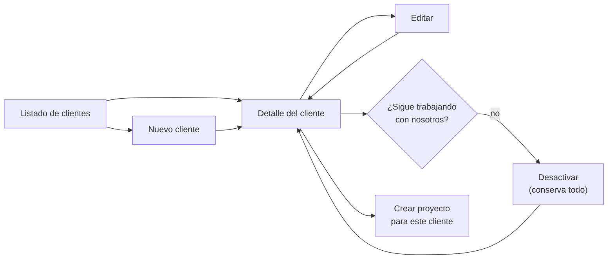

# Módulo: Clientes

> Escrito en la **fase 05**. Cubre el catálogo de clientes y su relación con los
> proyectos.

## Propósito

Guarda a quién se le factura. Un **cliente** es la empresa o persona que contrata, y de
él cuelgan uno o más **proyectos**; de cada proyecto cuelgan sus periodos y sus pagos.

Es el catálogo del que arranca todo lo demás: sin cliente no hay proyecto, y sin proyecto
no hay tareas ni cobros. Por eso su regla central no es cómo se crea sino cómo **no** se
borra.

## Modelo de datos

Una sola tabla, `clientes`:

| Columna | Tipo | Notas |
|---|---|---|
| `id` | `bigint` | |
| `nombre` | `string` | Obligatorio. Es el único campo requerido |
| `contacto_nombre` | `string?` | Persona con la que se habla |
| `contacto_email` | `string?` | |
| `contacto_telefono` | `string?` | |
| `notas` | `text?` | **Internas.** El cliente nunca las alcanza |
| `activo` | `boolean` | Por defecto `true` |

Relación: `clientes 1—N proyectos`, con `proyectos.cliente_id` **`restrictOnDelete()`**.

## Reglas de negocio

1. **Un cliente nunca se borra, se desactiva.** La clave foránea es `restrict` y de sus
   proyectos cuelgan periodos y pagos: borrarlo sería borrar el historial que justifica
   cobros ya hechos.
2. **Un cliente inactivo no admite proyectos nuevos**, pero conserva intactos los que ya
   tiene, con todo su historial, y sigue siendo consultable.
3. **La restricción se aplica en la validación, no solo en el desplegable.** Enviar a
   mano el `id` de un cliente desactivado al crear un proyecto devuelve un 422.
4. **El catálogo es global**: los clientes no cuelgan de ningún proyecto, así que la
   autorización depende solo del rol global.
5. **`notas` es interno sin excepción.** No tiene marca de `Visibilidad` porque no la
   necesita: nunca se expone en ninguna vista que alcance alguien del cliente.

## Flujo principal

## Rutas y controladores

| Método | URI | Controlador | Permiso requerido |
|---|---|---|---|
| GET | `clientes` | `ClienteController@index` | `ClientePolicy@viewAny` |
| GET | `clientes/crear` | `ClienteController@create` | `clientes.crear` |
| POST | `clientes` | `ClienteController@store` | `clientes.crear` |
| GET | `clientes/{cliente}` | `ClienteController@show` | `ClientePolicy@view` |
| GET | `clientes/{cliente}/editar` | `ClienteController@edit` | `clientes.crear` |
| PUT | `clientes/{cliente}` | `ClienteController@update` | `clientes.crear` |
| PUT | `clientes/{cliente}/estado` | `EstadoClienteController@update` | `clientes.crear` |

El listado se sirve con **`spatie/laravel-query-builder`** (`filter[nombre]` parcial,
`filter[activo]` exacto, orden por `nombre` o `created_at`, y **varios campos a la vez**
con `sort=nombre,-created_at`).

Desde la fase 07 lo pinta **`TablaDatos`** —ver [`tabla-de-datos.md`](tabla-de-datos.md)—
con el nombre anclado a la izquierda y la columna de correo oculta por defecto: ocupa
mucho y casi nunca se lee desde el listado. La acción de activar y desactivar vive en su
propia columna, porque un cliente **nunca se borra, se desactiva**.

## Permisos

| Rol | Puede |
|---|---|
| Administrador | Todo: crear, editar, activar y desactivar |
| Líder | Ver el catálogo. No lo modifica: `clientes.crear` es solo del administrador |
| Colaborador | Ver el catálogo |
| Observador / Cliente | El rol global `invitado` **no ve el catálogo**: es información de negocio de todos los clientes, no del suyo |

El rol de proyecto no interviene: los clientes no cuelgan de ningún proyecto.

## Decisiones de diseño

### Desactivar en lugar de borrar

**Elegido:** un `boolean activo` y ninguna ruta de borrado.

**Descartado — borrado suave (`softDeletes`)**: no aporta nada aquí. La pregunta que se
hace de un cliente no es «¿existe todavía?» sino «¿le seguimos facturando?», y esa es
una respuesta de negocio que el usuario cambia a mano en los dos sentidos. Un
`deleted_at` invita además a filtrar por `withTrashed()` en sitios donde el historial de
pagos tiene que aparecer siempre.

**Descartado — borrado real con `cascade`**: borraría periodos y pagos. Es exactamente el
dato que nadie puede permitirse perder.

### El cliente inactivo sigue apareciendo al editar su proyecto

El desplegable de creación solo ofrece clientes activos, pero el de **edición** incluye
además el cliente actual del proyecto aunque esté desactivado. Si no, corregir una errata
en la descripción de un proyecto viejo obligaría a reactivar al cliente, guardarlo y
volver a desactivarlo — tres pasos con estados intermedios erróneos para un cambio que no
tiene nada que ver con el cliente.

### El resumen del detalle mira los tres números que se preguntan de verdad

Proyectos activos, tareas abiertas y último periodo cerrado. No un panel de métricas: son
las tres preguntas que uno se hace al abrir la ficha de un cliente antes de una llamada.
«Tareas abiertas» usa `Tarea::scopeActivas()`, es decir, todo lo que no está `entregada`
ni `cancelada`.

## Puntos de extensión

- **Más campos de contacto**: añadir columnas a `clientes` y a `ClienteRequest`. Si algún
  día hay varios contactos por cliente, es una tabla nueva, no más columnas.
- **Filtros nuevos en el listado**: se añaden en `allowedFilters()` de
  `ClienteController@index`, nunca armando `where` a mano desde la request.
- **Adjuntos del cliente** (contratos, NDA): `Cliente` todavía no implementa `HasMedia`.
  Al añadirlo hay que registrar la colección **y** cubrirla en `MediaPolicy`, que hoy
  resuelve el proyecto de un adjunto y no sabría de dónde cuelga uno de cliente.
- **Portal del cliente**: si algún día alguien del cliente entra a su propia ficha, este
  módulo necesita un scope de visibilidad como el de `Reunion`. Hoy no lo tiene porque el
  catálogo es interno entero.
