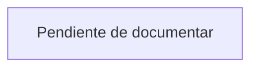

# Módulo: Dashboard

> **Pendiente.** Este archivo se rellena en la **fase 12**. La estructura de
> abajo es obligatoria: respeta las secciones y su orden.

## Propósito

Qué resuelve, en dos o tres frases. Escrito para alguien que no conoce el sistema.

## Modelo de datos

Tablas involucradas, con sus columnas relevantes y sus relaciones.

## Reglas de negocio

Las invariantes que el módulo garantiza. **Numeradas**, para poder referenciarlas
desde el código y desde otros documentos.

1. …

## Flujo principal

Diagrama Mermaid del recorrido más común del usuario.

## Rutas y controladores

| Método | URI | Controlador | Permiso requerido |
|---|---|---|---|
| | | | |

## Permisos

Qué puede hacer cada rol.

| Rol | Puede |
|---|---|
| Administrador | |
| Líder | |
| Colaborador | |
| Observador / Cliente | |

## Decisiones de diseño

Qué se consideró, qué se eligió y **por qué**. Especialmente las **alternativas
descartadas**: eso es lo que evita que alguien las reintente dentro de seis meses.

## Puntos de extensión

Dónde tocar para agregar funcionalidad sin romper lo existente.
