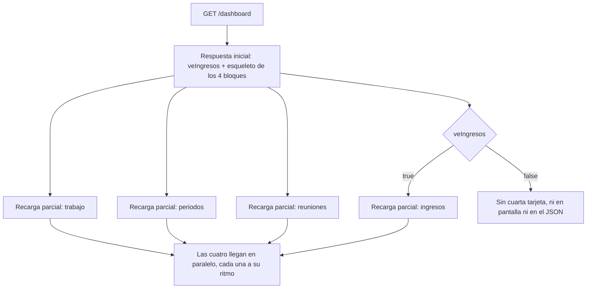

# Módulo: Dashboard

> Escrito en la **fase 12**. Cubre la pantalla de entrada tras iniciar sesión.

## Propósito

Es lo primero que se ve al entrar. Responde, sin tener que navegar a nada, cuatro
preguntas: qué tengo parado ahora mismo, qué periodos siguen abiertos, qué se habló
últimamente, y cuánto ha entrado por cliente. La tercera y la cuarta existen porque son
justo las que se olvidan cuando viven en pantallas propias que nadie abre por costumbre.

No agrega nada que no exista ya en otra pantalla: cada bloque es una consulta acotada
sobre datos que `tareas`, `periodos`, `reuniones` y `pagos` ya tienen, con su propio
enlace a la vista completa.

## Modelo de datos

No añade tablas. Lee de las que ya existen:

| Bloque | Tablas | Filtro de visibilidad |
|---|---|---|
| Tu trabajo de hoy | `tareas`, `historial_estados` | `Tarea::visiblesPara()` |
| Periodos abiertos | `periodos`, `tareas` | Proyectos del usuario (`ResolverRolProyecto::proyectosDelUsuario()`) |
| Últimas reuniones | `reuniones` | `Reunion::visiblesPara()` |
| Ingresos por cliente | `pagos`, `periodos`, `proyectos`, `clientes` | Rol de proyecto ≠ `cliente`, ver más abajo |

## Reglas de negocio

1. **Cuatro bloques, cuatro diferidos independientes.** Cada uno viaja en su propio
   grupo de `Inertia::defer()`. Sin grupo propio, Inertia agrupa todos los diferidos de
   una página en una sola petición y el más lento retrasa a los demás.
2. **"Tiempo parado" se mide desde que la tarea entró a su estado actual**, no desde su
   última edición. Se lee de `historial_estados` (el último registro de esa tarea); una
   tarea sin historial —creada directo en ese estado, fuera del flujo normal— cae a su
   `created_at`.
3. **El bloque de ingresos agrupa por cliente, no por proyecto.** Un cliente con dos
   proyectos ve un solo total.
4. **Solo cuentan los periodos cerrados.** Un pago de un periodo abierto no entra en la
   suma: el periodo puede reabrirse en el sentido de que su cierre todavía no es
   definitivo hasta que alguien lo cierra a mano.
5. **`veIngresos` viaja siempre; `ingresos` falta del todo si es falso.** La bandera es
   barata (no consulta pagos) y le dice a la interfaz si debe pedir el bloque. El dato
   pesado —el dinero— nunca se anuncia como diferido para quien no puede verlo: el JSON
   de Inertia viaja completo y se lee desde el navegador, así que ocultar la tarjeta en
   pantalla no basta.
6. **Ver ingresos exige las dos cosas que exige `PagoPolicy::viewAny()`**: rol global que
   ve lo interno, permiso `pagos.ver`, y rol de proyecto distinto de `cliente` — evaluado
   por proyecto, no de forma global, porque alguien puede ser `cliente` en un proyecto y
   `líder` en otro.
7. **El administrador ve todos los proyectos**, tenga o no fila en el pivote
   `proyecto_usuario`: los cuatro bloques usan las mismas reglas que ya distinguen admin
   del resto en `Tarea::visiblesPara()` y `Reunion::visiblesPara()`, replicadas a mano
   para `periodos` y `pagos`, que no tienen scope propio.

## Flujo principal

## Rutas y controladores

| Método | URI | Controlador | Permiso requerido |
|---|---|---|---|
| GET | `/dashboard` | `DashboardController@index` | `auth`, `verified` — sin policy propia, cada bloque se acota solo |

## Permisos

| Rol | Puede |
|---|---|
| Administrador | Ve los cuatro bloques con datos de todos los proyectos. |
| Líder / Colaborador / Observador | Ven los cuatro bloques acotados a sus proyectos. El bloque de ingresos solo si el rol de proyecto no es `cliente` en ninguno y el rol global ve lo interno. |
| Cliente (rol de proyecto) | Ve trabajo, periodos y reuniones (esta última ya recortada a lo marcado `Visibilidad::Cliente`). Nunca ve el bloque de ingresos. |

## Decisiones de diseño

### Cuatro grupos de `Inertia::defer()`, no uno

La forma obvia —cuatro `Inertia::defer(fn () => …)` sin segundo argumento— cae en el
mismo grupo (`'default'`) y el cliente los pide **todos en una sola petición**: el bloque
de ingresos, que hace el `join` más largo, retrasaría a los otros tres aunque ya
estuvieran listos. Cada bloque lleva su propio nombre de grupo
(`Inertia::defer(fn () => …, 'trabajo')`) para que el cliente dispare cuatro peticiones en
paralelo.

### `veIngresos` es una prop normal; `ingresos` es la única diferida que puede faltar

El resto de bloques siempre se anuncian —quien no tiene tareas ve una lista vacía, no un
bloque ausente—. Los ingresos son distintos: para un `cliente` la clave **no existe en
absoluto**, ni siquiera diferida y vacía, porque el patrón ya usado en
`ProyectoController::show` (`respaldos`) es que un dato que un rol no puede ver falta del
todo, nunca viaja como `[]` o `null` disfrazando una decisión de autorización de un simple
"todavía no hay datos". Como esa decisión (¿puede ver ingresos en algún proyecto?) es
barata de calcular y no depende de traer los pagos, se manda aparte y sin diferir: así la
interfaz sabe si debe pedir la cuarta tarjeta sin tener que pedirla primero para
comprobarlo.

### "Tiempo parado" es tiempo en el estado, no tiempo desde la última edición

Ordenar por `updated_at` fue la primera idea y se descartó: editar la descripción de una
tarea toca `updated_at` sin que la tarea se haya movido, y el bloque mentiría diciendo que
acaba de tener actividad. `historial_estados` ya registra cada transición
(`TareaObserver@updated`), así que la fecha de entrada al estado actual es su último
registro para esa tarea — una sola subconsulta correlacionada, no una petición por fila.

### Periodos y pagos no tienen `scopeVisiblesPara()`, y no se les añadió uno

`Tarea` y `Reunion` sí lo tienen porque un listado de cada uno existe en varias pantallas.
Periodos y pagos, hasta la fase 12, siempre se listaban ya colgando de `{proyecto}` en la
URL (`proyectos/{p}/periodos`), así que la autorización nunca necesitó acotar por una
lista de proyectos - discriminaba uno solo, ya resuelto por la policy. El dashboard es el
primer sitio que necesita "todos los periodos de todos mis proyectos", así que la
resolución de proyectos visibles se hizo a mano en el controlador
(`ResolverRolProyecto::proyectosDelUsuario()` para periodos; el equivalente con el filtro
de rol de proyecto para pagos) en lugar de forzar un scope nuevo en dos modelos que no
lo necesitan en ningún otro sitio todavía. Si aparece un segundo listado transversal de
periodos o pagos, ese es el momento de promover esto a scope.

### El total de ingresos usa `(float)` antes de formatear, igual que `total_pagado_usd`

`SUM(monto_cop)` es un agregado de la consulta, no pasa por el cast `decimal:2` del
modelo, y MySQL no da el mismo tipo para "cero filas" que para una suma real. Se sigue el
mismo patrón ya establecido en `ProyectoController::resumen()`: cast explícito a `float`
y `number_format()` a mano, en vez de inventar un segundo camino para el mismo problema.

## Puntos de extensión

- **Un quinto bloque**: necesita su propio grupo de `Inertia::defer()` y, si toca datos
  con visibilidad de rol, su propia bandera barata como `veIngresos` si hace falta
  ocultar la tarjeta entera.
- **Filtrar el bloque de trabajo por proyecto**: hoy trae de todos los proyectos del
  usuario mezclados; un selector de proyecto sería un parámetro de consulta más sobre el
  mismo `DashboardController@index`, no una ruta nueva.
- **Gráfica de ingresos por periodo**: el bloque actual es una lista con un número. Si en
  algún momento hiciera falta comparar periodos entre sí, ahí sí una barra ayuda de
  verdad — hasta entonces, un número basta.
