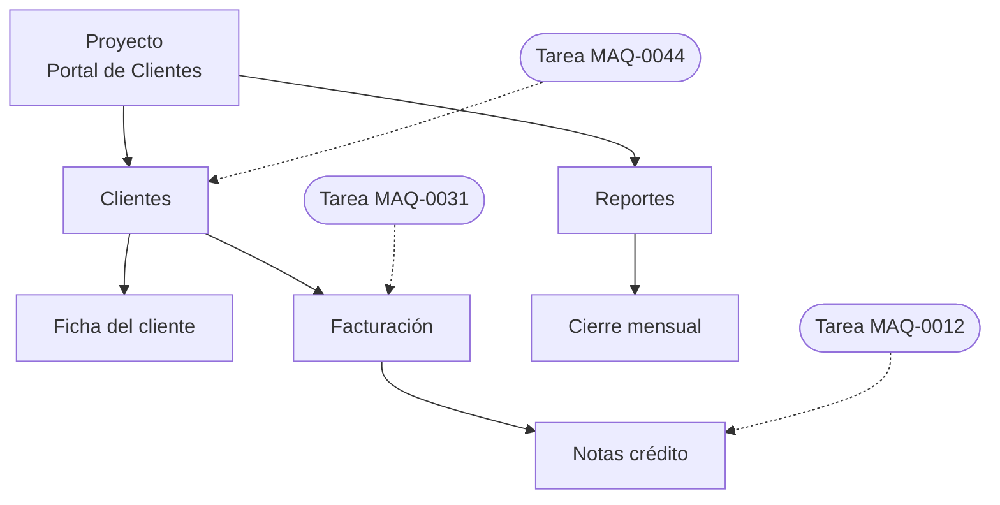
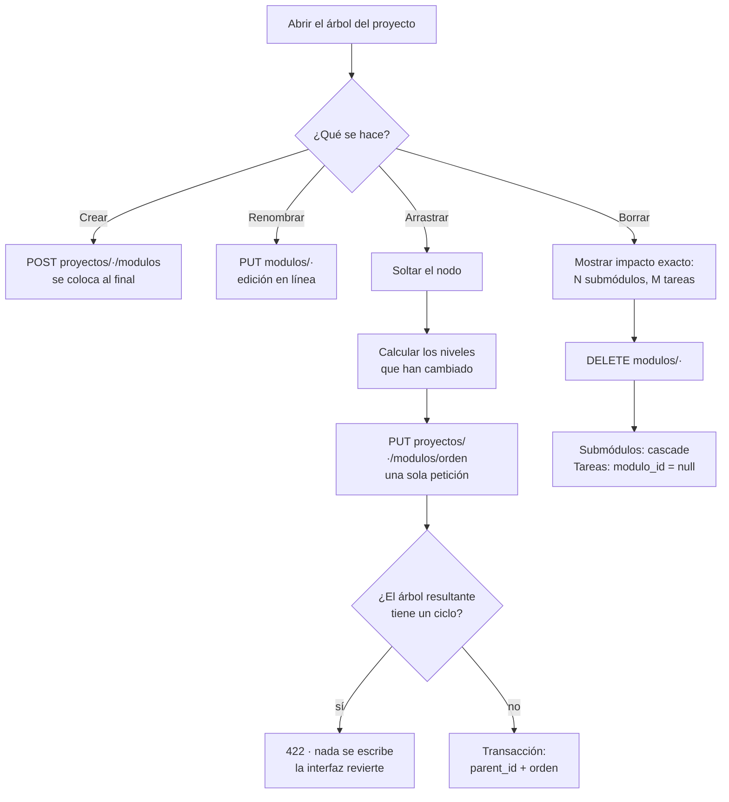

# Módulo: Módulos

> Escrito en la **fase 05**. Cubre el árbol de módulos de un proyecto: creación,
> renombrado, reordenación, cambio de padre y borrado.

## Propósito

Un **módulo** es una división funcional de un proyecto —«Clientes», «Facturación»,
«Reportes»—, y puede contener submódulos. Sirve para agrupar tareas por zona del sistema:
al mirar un periodo, la pregunta «¿qué se tocó de facturación?» se responde por módulo.

Es el único árbol autoreferencial del dominio, y por eso el único sitio donde hacen falta
prevención de ciclos y una reordenación transaccional.

## Modelo de datos

Tabla `modulos`:

| Columna | Tipo | Notas |
|---|---|---|
| `id` | `bigint` | |
| `proyecto_id` | `bigint` | FK a `proyectos`, **`cascadeOnDelete()`** |
| `parent_id` | `bigint?` | FK a `modulos`, **`cascadeOnDelete()`**. `null` = raíz |
| `nombre` | `string` | |
| `descripcion` | `text?` | |
| `orden` | `integer` | Posición entre sus hermanos, base 0 |

Índice compuesto en `(proyecto_id, parent_id, orden)`, que es exactamente como se lee el
árbol.

Y desde el otro lado: `tareas.modulo_id` es **`nullOnDelete()`**. Es la asimetría central
del módulo y está explicada abajo.



El contador que se ve junto a «Clientes» sería **3**: la suya más las de `Facturación` y
`Notas crédito`.

## Reglas de negocio

1. **Un módulo no puede colgar de uno de sus propios descendientes.** Se valida en el
   servidor (`ReordenarModulos`), no solo en la interfaz.
2. **La comprobación se hace sobre el árbol resultante, no movimiento a movimiento.** Dos
   cambios inocentes por separado pueden formar un ciclo al aplicarse juntos.
3. **Una operación de arrastre es una sola petición.** Se envían los niveles afectados
   enteros —cada padre con el orden completo de sus hijos—, y entran en una transacción.
4. **`parent_id` y los módulos reordenados tienen que ser del mismo proyecto.** Se valida
   con `Rule::exists()` acotado a `proyecto_id`.
5. **Borrar un módulo borra sus submódulos en cascada, pero no sus tareas**: las tareas
   quedan con `modulo_id` nulo.
6. **La confirmación de borrado dice los números exactos** de submódulos y de tareas
   afectados, contando descendientes.
7. **El contador de tareas de un módulo incluye las de sus descendientes.**
8. **Un módulo nuevo se coloca al final de sus hermanos**, no al principio.
9. **La estructura del proyecto la define quien lo lidera.** `ModuloPolicy@create`,
   `@update` y `@delete` exigen `ResolverRolProyecto::gestiona()`; un colaborador lee el
   árbol pero no lo toca.

## Flujo principal



## Rutas y controladores

| Método | URI | Controlador | Permiso requerido |
|---|---|---|---|
| GET | `proyectos/{proyecto}/modulos` | `ModuloController@index` | `ModuloPolicy@viewAny` |
| POST | `proyectos/{proyecto}/modulos` | `ModuloController@store` | `ModuloPolicy@create` |
| PUT | `proyectos/{proyecto}/modulos/orden` | `ReordenarModulosController@update` | `ModuloPolicy@create` |
| PUT | `modulos/{modulo}` | `ModuloController@update` | `ModuloPolicy@update` |
| DELETE | `modulos/{modulo}` | `ModuloController@destroy` | `ModuloPolicy@delete` |

Piezas de apoyo:

- **`App\Services\ArbolDeModulos`** — arma el árbol y sus conteos recursivos.
- **`App\Actions\ReordenarModulos`** — valida ciclos y persiste en una transacción.
- **`App\Exceptions\CicloEnElArbol`** — la excepción de dominio; el controlador la
  traduce a un 422.
- **`resources/js/components/modulos/ModuloNodo.vue`** — el nodo recursivo.

### Formato de la petición de reordenación

```json
{
  "niveles": [
    { "parent_id": null, "modulos": [12, 9, 15] },
    { "parent_id": 9,    "modulos": [22, 21] }
  ]
}
```

Cada entrada es **un nivel completo**: su padre y el orden de todos sus hijos.
`parent_id: null` es la raíz. Un nivel que se vació entero se envía con `modulos: []`.

## Permisos

| Rol | Puede |
|---|---|
| Administrador | Todo (entra por `Gate::before`) |
| Líder | Crear, renombrar, reordenar, mover y borrar módulos |
| Colaborador | Ver el árbol y sus conteos. No lo modifica |
| Observador / Cliente | Ver el árbol |

Un `invitado` global no escribe nada, aunque su rol de proyecto sea `lider`:
`ResolverRolProyecto::gestiona()` exige que el rol global permita escribir.

## Decisiones de diseño

### Prevención de ciclos: simular el resultado, no validar cada movimiento

**Elegido:** construir en memoria el mapa `id → parent_id` que quedaría tras aplicar
**todos** los niveles de la petición, y recorrer hacia arriba desde cada nodo con un
conjunto de visitados. Si se vuelve a pasar por uno, hay ciclo y no se escribe nada.

**Descartado — comprobar cada nivel por separado.** Deja pasar el caso en que ningún
movimiento crea un ciclo por sí solo pero los dos juntos sí: mover `A` bajo `B` es
válido, mover `B` bajo `A` también lo es, y aplicados a la vez se cierra el bucle. La
prueba `detecta el ciclo que solo aparece al aplicar dos niveles juntos` es la que fija
esta decisión.

**Descartado — confiar en que la interfaz no lo permita.** Sortable, de hecho, no deja
soltar un nodo dentro de su propio subárbol, porque ese subárbol viaja con él. Pero el
endpoint es alcanzable sin la interfaz, y una recursión infinita al renderizar no es un
fallo que se quiera descubrir en producción.

El síntoma que esto evita es concreto: la rama se desengancha del árbol —deja de ser
alcanzable desde ninguna raíz— y el componente recursivo se queda dando vueltas.

### Una petición por arrastre, con los niveles completos

**Elegido:** el cliente calcula qué niveles cambiaron comparando el árbol que está
manipulando con la última copia confirmada por el servidor, y manda solo esos, enteros.

**Descartado — una petición por nodo movido.** Un arrastre entre dos listas cambia el
orden de varios hermanos a la vez; con diez peticiones seguidas, que falle la séptima
deja el árbol en un estado que nadie pidió y que el usuario no sabe deshacer.

**¿Y si la petición falla a medias?** No puede: la escritura va dentro de una
`DB::transaction()`, y la validación de ciclos ocurre **antes** de abrirla. O entra
entera o no entra nada. En el cliente, `onError` devuelve el árbol local a la última copia
confirmada, de modo que la pantalla no se queda enseñando un orden que el servidor
rechazó.

### Dos consultas para el árbol, sea cual sea su profundidad

**Elegido:** una consulta para todos los módulos del proyecto y otra para las tareas
agrupadas por `modulo_id`. El árbol y los conteos acumulados se ensamblan en memoria.

**Descartado — `with('hijos.hijos')`.** Fija la profundidad en el código —tres niveles
sería `hijos.hijos.hijos`— y dispara una consulta por nivel. Con los 33 módulos que
siembra el seeder no se nota; con 200 y varios niveles, sí.

**Descartado — CTE recursiva en SQL.** Resolvería la carga, pero los conteos acumulados
hacia arriba habría que sumarlos igualmente en PHP, y a cambio se pierde portabilidad.

La prueba `carga el árbol con un número acotado de consultas` levanta 210 módulos en tres
niveles y afirma un techo de consultas muy por debajo del número de nodos.

### Las tareas no se borran con su módulo

`modulos.parent_id` es `cascadeOnDelete()` pero `tareas.modulo_id` es `nullOnDelete()`.
La asimetría es deliberada: un módulo es **una forma de agrupar**, y reorganizar la
agrupación no puede destruir el trabajo agrupado. Una tarea sin módulo es un estado
válido y recuperable; una tarea borrada por reorganizar el árbol no lo es.

Por eso la confirmación dice los dos números por separado: los submódulos **se borran**,
las tareas **se quedan sin módulo**.

### La clave de renderizado es el id, nunca el índice

Con `:key="indice"`, mover un nodo hace que Vue reutilice el DOM del hermano que ocupaba
esa posición: la rama que estaba colapsada aparece colapsada en otro nodo, y el campo en
edición salta al equivocado. El síntoma se lee como «el arrastre corrompe el árbol»
cuando en realidad los datos están bien y lo que falla es el emparejamiento del DOM.

Por la misma familia de problemas, `ModuloNodo` recibe sus hijos por `defineModel` en
lugar de escribir dentro de la prop `nodo`.

## Puntos de extensión

- **Descripción del módulo en línea**: `ModuloController@update` ya acepta `descripcion`;
  falta el campo en `ModuloNodo.vue`.
- **Mover tareas al borrar** en vez de dejarlas huérfanas: iría en `ModuloController@destroy`,
  antes del `delete()`, reasignando `modulo_id` al padre. Hoy no se hace porque «sin
  módulo» es una bandeja de entrada legítima.
- **Límite de profundidad**: el árbol admite profundidad arbitraria. Si alguna vez hay que
  acotarla, el sitio es `ReordenarModulos`, junto a la validación de ciclos, y también
  `ModuloRequest` para la creación.
- **Filtrar tareas por módulo incluyendo descendientes** (fase 06): reutilizar
  `ArbolDeModulos::descendientes()`, que ya resuelve la lista con una sola consulta.
