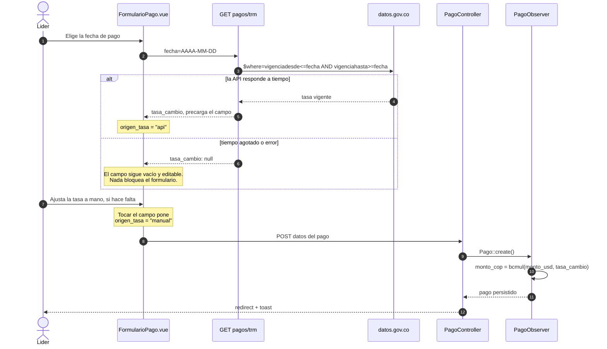

# Módulo: Pagos

## Propósito

Un pago es el cobro de un periodo: cuánto se cobró en dólares, a qué tasa de cambio y
cuánto son esos dólares en pesos. Es el único sitio del sistema donde hay dinero, y por
eso es donde más importa que los números no se muevan solos.

## Modelo de datos

Tabla: **`pagos`**. Diccionario completo en
[`../02-modelo-de-datos.md`](../02-modelo-de-datos.md).

- **`periodo_id` es UNIQUE.** Un periodo, un pago.
- **`monto_usd` `decimal(12,2)`**, **`tasa_cambio` `decimal(12,4)`**, **`monto_cop`
  `decimal(14,2)`**. Nunca `float`.
- **`origen_tasa`** (`OrigenTasaCambio`) registra si la TRM vino de la API o se escribió
  a mano.
- Los casts del modelo son `decimal:2` y `decimal:4`, así que los montos llegan como
  cadenas, no como `float`. **No los pases por `floatval()` para operar.**

## Reglas de negocio

1. **Un periodo tiene exactamente un pago** (D4.2).
2. **La TRM se consulta a la fecha del pago**, no a la de hoy, y queda siempre editable
   a mano (D4.5).
3. **`monto_cop` se persiste calculado, no se deriva al leer** (D4.6). Corregir mañana
   la tasa de un pago viejo no debe reescribir lo que ya se cobró.
4. **El cálculo va por `bcmath` sobre cadenas**, con redondeo comercial a dos decimales.
5. **El cliente no ve los pagos** (D6.3). El reporte de cliente no lleva columnas de
   dinero (D7.1). La regla se aplica en dos sitios a la vez —`PagoPolicy` para el
   acceso directo, y cada respuesta que incluye un pago ajeno (el índice y el detalle de
   `Periodo`) lo omite explícitamente para quien no tiene el permiso, no solo lo oculta
   en la interfaz—.
6. **Ninguna consulta a la TRM bloquea el registro de un pago** (D4.12). Un tiempo de
   espera corto, un solo intento, y si falla el campo sigue siendo editable a mano.

## Flujo principal

## Rutas y controladores

| Método | URI | Controlador | Permiso requerido |
|---|---|---|---|
| GET | `proyectos/{p}/pagos` | `PagoController@index` | `viewAny` |
| GET | `proyectos/{p}/pagos/crear` | `PagoController@create` | `create` |
| POST | `proyectos/{p}/pagos` | `PagoController@store` | `create` |
| GET | `pagos/{pago}` | `PagoController@show` | `view` |
| GET | `pagos/{pago}/editar` | `PagoController@edit` | `update` |
| PUT | `pagos/{pago}` | `PagoController@update` | `update` |
| GET | `pagos/trm` | `PagoController@trm` | Autenticado. No expone datos de un proyecto: es una tasa de mercado pública. |

## Permisos

| Rol | Puede |
|---|---|
| Administrador | Todo, vía `Gate::before`. |
| Líder | Ver y registrar pagos de sus proyectos. |
| Colaborador / Observador | Nada: `PagoPolicy` exige `Permiso::PagosVer` o `Permiso::PagosRegistrar`, que hoy solo tiene el líder. |
| Cliente | Nada, **nunca**, sin excepción y sin depender de la interfaz (D6.3). |

## Decisiones de diseño

### `monto_cop` se guarda, no se calcula al leer

**Alternativa descartada: un accesor que multiplique en cada lectura.** Ahorra una
columna y garantiza que el valor "siempre cuadra". El problema es justo ese: si alguien
corrige la TRM de un pago de marzo, el informe de marzo cambia retroactivamente y la
cifra que se le envió al cliente deja de existir en el sistema.

Guardar el resultado congela el histórico. El precio es que la columna puede quedar
desalineada si alguien escribe en la base por fuera del modelo; el observer la recalcula
en cada `saving`, y una prueba comprueba las dos caras: que un `UPDATE` directo **no**
la cambia, y que volver a guardar el modelo **sí**.

### El cálculo va por `bcmath`, no por aritmética de PHP

`1234.56 * 4123.4567` en coma flotante binaria no da exactamente `5090654.70`. Sobre
montos de un periodo la diferencia es de centavos; sobre el acumulado de un año, es la
razón por la que un reporte no cuadra y nadie sabe por qué.

`bcmul` opera sobre cadenas con la escala que se le pida. El redondeo comercial se hace
sumando medio centavo antes de truncar a dos decimales, porque `bcadd` con escala trunca
en lugar de redondear.

### La TRM se consulta desde el navegador, no desde el servidor al guardar

**Alternativa descartada: resolver la TRM en `PagoController@store`, en el momento de
guardar.** Parecía más simple —una sola llamada, sin endpoint aparte— pero ataba el
`POST` que persiste el pago a la disponibilidad de un servicio externo: una API lenta
convierte "guardar un pago" en "esperar a datos.gov.co para guardar un pago", que es
justo la dependencia que D4.12 prohíbe.

`GET pagos/trm` es una consulta aparte, disparada al elegir la fecha, con su propio
tiempo de espera acotado. El formulario **precarga** el valor si llega a tiempo y sigue
funcionando igual si no llega: guardar el pago nunca depende de que la API responda.

### Por qué la TRM se busca por rango, no por igualdad

Verificado contra la API real antes de escribir el `$where`: la TRM se publica por
rangos de vigencia (`vigenciadesde` / `vigenciahasta`), no un valor por cada día. Un
viernes cubre también el fin de semana. Pedir `vigenciadesde = fecha` devuelve `[]`
para un sábado o un domingo; el filtro correcto es
`vigenciadesde <= fecha AND vigenciahasta >= fecha`, ordenado por `vigenciadesde`
descendente con límite 1.

### La caché no expira

`Cache::forever()` por fecha, sin `Cache::forget()` en ningún sitio: la TRM de un día
que ya pasó no cambia, así que no hay ninguna condición bajo la cual volver a pedirla
mejore la respuesta. Solo se cachea un valor resuelto —nunca un fallo—, para que una
caída puntual de la API no deje una fecha "envenenada" sin tasa para siempre.

## Puntos de extensión

- **Otras monedas.** Hoy el par está fijo: USD como moneda de cobro, COP como moneda de
  conversión. Añadir una tercera implica columnas de moneda, no una tasa distinta.
- **Editar un pago después de que su periodo lleve tiempo cerrado.** Hoy `PagoPolicy`
  no distingue por antigüedad; si algún día hace falta congelar un pago pasado un
  plazo, el sitio es ahí.
