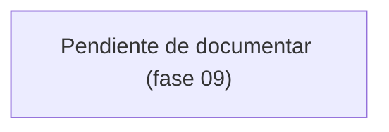

# Módulo: Pagos

> **Parcial.** El modelo de datos y las reglas de negocio se escribieron en la
> **fase 03**. Rutas, controladores, permisos y consulta de TRM quedan para la
> **fase 09**.

## Propósito

Un pago es el cobro de un periodo: cuánto se cobró en dólares, a qué tasa de cambio y
cuánto son esos dólares en pesos. Es el único sitio del sistema donde hay dinero, y por
eso es donde más importa que los números no se muevan solos.

## Modelo de datos

Tabla: **`pagos`**. Diccionario completo en
[`../02-modelo-de-datos.md`](../02-modelo-de-datos.md).

- **`periodo_id` es UNIQUE.** Un periodo, un pago.
- **`monto_usd` `decimal(12,2)`**, **`tasa_cambio` `decimal(12,4)`**, **`monto_cop`
  `decimal(14,2)`**. Nunca `float`.
- **`origen_tasa`** (`OrigenTasaCambio`) registra si la TRM vino de la API o se escribió
  a mano.
- Los casts del modelo son `decimal:2` y `decimal:4`, así que los montos llegan como
  cadenas, no como `float`. **No los pases por `floatval()` para operar.**

## Reglas de negocio

1. **Un periodo tiene exactamente un pago** (D4.2).
2. **La TRM se consulta a la fecha del pago**, no a la de hoy, y queda siempre editable
   a mano (D4.5).
3. **`monto_cop` se persiste calculado, no se deriva al leer** (D4.6). Corregir mañana
   la tasa de un pago viejo no debe reescribir lo que ya se cobró.
4. **El cálculo va por `bcmath` sobre cadenas**, con redondeo comercial a dos decimales.
5. **El cliente no ve los pagos** (D6.3). El reporte de cliente no lleva columnas de
   dinero (D7.1).

## Flujo principal

*Pendiente de la fase 09.*

## Rutas y controladores

*Fase 09.*

| Método | URI | Controlador | Permiso requerido |
|---|---|---|---|
| | | | |

## Permisos

*Fase 09.*

| Rol | Puede |
|---|---|
| Administrador | |
| Líder | |
| Colaborador | |
| Observador / Cliente | |

## Decisiones de diseño

### `monto_cop` se guarda, no se calcula al leer

**Alternativa descartada: un accesor que multiplique en cada lectura.** Ahorra una
columna y garantiza que el valor "siempre cuadra". El problema es justo ese: si alguien
corrige la TRM de un pago de marzo, el informe de marzo cambia retroactivamente y la
cifra que se le envió al cliente deja de existir en el sistema.

Guardar el resultado congela el histórico. El precio es que la columna puede quedar
desalineada si alguien escribe en la base por fuera del modelo; el observer la recalcula
en cada `saving`, y una prueba comprueba las dos caras: que un `UPDATE` directo **no**
la cambia, y que volver a guardar el modelo **sí**.

### El cálculo va por `bcmath`, no por aritmética de PHP

`1234.56 * 4123.4567` en coma flotante binaria no da exactamente `5090654.70`. Sobre
montos de un periodo la diferencia es de centavos; sobre el acumulado de un año, es la
razón por la que un reporte no cuadra y nadie sabe por qué.

`bcmul` opera sobre cadenas con la escala que se le pida. El redondeo comercial se hace
sumando medio centavo antes de truncar a dos decimales, porque `bcadd` con escala trunca
en lugar de redondear.

## Puntos de extensión

- **Consulta automática de la TRM** a la fecha del pago (fase 09). El `origen_tasa` ya
  distingue `api` de `manual`, así que basta con rellenar la tasa y marcar el origen.
- **Otras monedas.** Hoy el par está fijo: USD como moneda de cobro, COP como moneda de
  conversión. Añadir una tercera implica columnas de moneda, no una tasa distinta.
