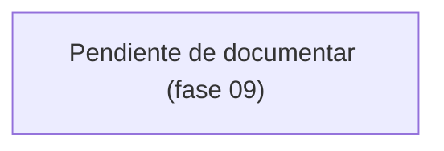

# Módulo: Periodos

> **Parcial.** El modelo de datos y las reglas de negocio se escribieron en la
> **fase 03**. Rutas, controladores, permisos y flujo de cierre quedan para la
> **fase 09**.

## Propósito

Un periodo es un bloque de trabajo facturable de un proyecto: una fecha de inicio, una
fecha de fin y un pago. Es la unidad con la que se cobra y con la que se rinde cuentas
al cliente. Informalmente equivale a "unas cien horas", pero **eso es contexto de
negocio, no un dato que se capture**: el sistema no registra horas.

## Modelo de datos

Tablas: **`periodos`** y, a través de ellas, **`tareas`** (`periodo_id` y
`periodo_origen_id`) y **`reportes`**. Diccionario completo en
[`../02-modelo-de-datos.md`](../02-modelo-de-datos.md).

- **`fecha_fin` es nullable.** Un periodo abierto no la tiene: se llena al cerrar.
- **Unique en `(proyecto_id, consecutivo)`.** El consecutivo es por proyecto.
- **`estado`** es `EstadoPeriodo`: `abierto` o `cerrado`.
- Borrar un periodo **no borra sus tareas**: quedan con `periodo_id` nulo (`set null`).

Relaciones del modelo `Periodo`: `proyecto`, `pago` (**`hasOne`**, no `hasMany`),
`tareas`, `tareasArrastradas`, `reportes`. Métodos: `estaVencido()`,
`duracionEnDias()`. Scopes: `abiertos()`, `cerrados()`.

## Reglas de negocio

1. **Los periodos son por proyecto, no por cliente** (D4.1).
2. **Un periodo tiene exactamente un pago** (D4.2), garantizado por el `unique` en
   `pagos.periodo_id`.
3. **El cierre es manual** (D4.3). El sistema nunca cierra un periodo solo: no hay job
   programado ni observer que lo haga al llegar la fecha de fin.
4. **Sobrepasar la fecha de fin no es un error** (D4.4). Es un estado válido y
   frecuente: la interfaz lo señala, la validación no lo rechaza.
5. **Una tarea no terminada puede arrastrarse al siguiente periodo** conservando
   `periodo_origen_id` (D4.7).
6. **No se registran horas** por periodo ni por tarea (D1.5).

## Flujo principal

*Pendiente de la fase 09.* Ver
[`../diagramas/flujo-cierre-periodo.md`](../diagramas/flujo-cierre-periodo.md).

## Rutas y controladores

*Fase 09.*

| Método | URI | Controlador | Permiso requerido |
|---|---|---|---|
| | | | |

## Permisos

*Fase 09.*

| Rol | Puede |
|---|---|
| Administrador | |
| Líder | |
| Colaborador | |
| Observador / Cliente | |

## Decisiones de diseño

### `fecha_fin` nullable en lugar de una fecha prevista obligatoria

**Alternativa descartada: `fecha_fin` obligatoria desde el inicio**, con el cierre
limitándose a cambiar el estado. Se descartó porque entonces la columna significa dos
cosas distintas según el estado —"fecha prevista" mientras está abierto, "fecha real"
cuando se cierra— y ningún informe puede confiar en ella.

Con `fecha_fin` nula mientras el periodo está abierto, la columna significa siempre lo
mismo: cuándo terminó de verdad. La consecuencia es que `estaVencido()` solo puede
responder algo útil cuando alguien ya fijó una fecha de fin, y eso es correcto.

### El pago es `hasOne`, no `hasMany`

Modelar el pago como colección invitaría a "un abono ahora y otro después", que es un
caso que este dominio no tiene. El `unique` en `pagos.periodo_id` cierra la puerta a
nivel de base de datos, no solo de intención.

## Puntos de extensión

- **Arrastre automático al cerrar.** Al cerrar un periodo, mover las tareas no
  terminales al siguiente fijando `periodo_origen_id`. La estructura ya lo soporta; la
  acción es de la fase 09.
- **Más de un periodo abierto por proyecto.** Hoy nada lo impide a nivel de base de
  datos. Si se decide que solo puede haber uno, el sitio es un índice único parcial o
  una validación en el cierre, no una comprobación en la interfaz.
