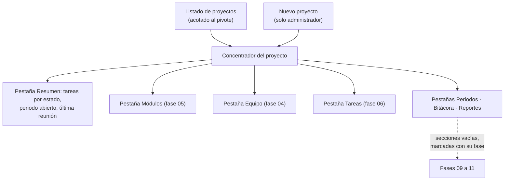

# Módulo: Proyectos

> Escrito en la **fase 05**. Cubre el CRUD de proyectos, el concentrador de trabajo y la
> asignación de personas. La asignación de roles se documenta en detalle en
> [`autenticacion.md`](autenticacion.md).

## Propósito

Un **proyecto** es una aplicación o sistema concreto de un cliente. Es la unidad
alrededor de la que gira todo el trabajo: tiene sus propios módulos, tareas, periodos,
pagos, reuniones y reportes, y su propia lista de personas con sus roles.

Su pantalla de detalle es el **concentrador**: el sitio desde el que se entra a todo lo
demás y donde se pasa la mayor parte del tiempo.

## Modelo de datos

Tabla `proyectos`:

| Columna | Tipo | Notas |
|---|---|---|
| `id` | `bigint` | |
| `cliente_id` | `bigint` | FK a `clientes`, **`restrictOnDelete()`** |
| `nombre` | `string` | |
| `slug` | `string` `unique` | Autogenerado desde el nombre; editable |
| `prefijo_tarea` | `string(10)` `unique` | **Inmutable** una vez hay códigos emitidos |
| `descripcion` | `text?` | |
| `estado` | `string(20)` | Enum `EstadoProyecto`: `activo`, `pausado`, `finalizado` |
| `deleted_at` | `timestamp?` | Borrado suave |

Relaciones: `N—1 clientes`, `1—N modulos`, `1—N tareas`, `1—N periodos`, `1—N reuniones`,
`1—N reportes`, `1—1 contadores_tarea`, y `N—M users` por el pivote `proyecto_usuario`
(que es la **única** fuente de verdad de los permisos dentro del proyecto).

## Reglas de negocio

1. **`prefijo_tarea` se normaliza siempre a mayúsculas y sin espacios.** El mutador vive
   en el modelo, así que un seeder o `tinker` tampoco pueden dejarlo en minúsculas.
2. **`prefijo_tarea` es inmutable en cuanto el proyecto emite su primer código.** Lo
   comprueba `ProyectoObserver@updating`, que aborta el guardado con `PrefijoInmutable`.
3. **«Emitió un código» mira el contador, no las tareas vivas.** Borrar la tarea no borra
   el código que ya viajó al cliente dentro de un reporte, así que
   `Proyecto::tieneCodigosEmitidos()` consulta `contadores_tarea.ultimo_numero`.
4. **Formato del prefijo**: de dos a diez caracteres, solo letras y números. Ni guiones ni
   símbolos: el prefijo se concatena al correlativo (`MAQ-0001`) y un guion haría el
   código ambiguo al partirlo.
5. **El slug se autogenera desde el nombre si llega vacío**, y la colisión se resuelve con
   sufijo numérico (`portal-de-clientes-2`). Lo hace `ProyectoObserver@creating`.
6. **Solo el administrador crea y borra proyectos.** `ProyectoPolicy@create` y `@delete`
   devuelven `false`; el administrador entra por `Gate::before`.
7. **Editar el proyecto es del líder**, y además exige el permiso global
   `proyectos.editar`. Un `invitado` global con rol de proyecto `lider` no puede.
8. **El cliente del proyecto debe estar activo**, salvo que ya fuera el suyo.
9. **Archivar es cambiar el estado a `finalizado`.** El borrado suave existe solo para
   deshacer una creación equivocada.

## Flujo principal

### El concentrador va por pestañas (fase 07)

Siete pestañas —resumen, módulos, equipo, tareas, periodos, bitácora y reportes— y **la
activa viaja en la URL** (`?seccion=tareas`), no solo en estado de Vue: se quiere poder
compartir un enlace a la bitácora de un proyecto y volver a la misma pestaña tras
recargar. `ProyectoController@show` la valida contra la lista, así que un `?seccion=`
inventado abre el resumen en vez de dejar la página en blanco.

Las pestañas de bitácora y reportes solo se listan si el rol las permite, pero eso es
cosmética: quien manda sigue siendo la policy de cada ruta.

## Rutas y controladores

| Método | URI | Controlador | Permiso requerido |
|---|---|---|---|
| GET | `proyectos` | `ProyectoController@index` | `ProyectoPolicy@viewAny` |
| GET | `proyectos/crear` | `ProyectoController@create` | `ProyectoPolicy@create` (administrador) |
| POST | `proyectos` | `ProyectoController@store` | `ProyectoPolicy@create` |
| GET | `proyectos/{proyecto}` | `ProyectoController@show` | `ProyectoPolicy@view` |
| GET | `proyectos/{proyecto}/editar` | `ProyectoController@edit` | `ProyectoPolicy@update` |
| PUT | `proyectos/{proyecto}` | `ProyectoController@update` | `ProyectoPolicy@update` |
| DELETE | `proyectos/{proyecto}` | `ProyectoController@destroy` | `ProyectoPolicy@delete` (administrador) |
| GET | `proyectos/{proyecto}/miembros` | `ProyectoUsuarioController@index` | `gestionarMiembros` |
| POST | `proyectos/{proyecto}/miembros` | `ProyectoUsuarioController@store` | `gestionarMiembros` |
| PUT | `proyectos/{proyecto}/miembros/{usuario}` | `ProyectoUsuarioController@update` | `gestionarMiembros` |
| DELETE | `proyectos/{proyecto}/miembros/{usuario}` | `ProyectoUsuarioController@destroy` | `gestionarMiembros` |
| POST | `proyectos/{proyecto}/equipos` | `AsignarEquipoAProyectoController@store` | `gestionarMiembros` |

El listado va por **query-builder** (`filter[nombre]`, `filter[estado]`,
`filter[cliente_id]`) y, para quien no es administrador, se acota a los proyectos donde
tiene fila en el pivote **antes** de cualquier filtro.

Desde la fase 07 lo pinta **`TablaDatos`** —ver [`tabla-de-datos.md`](tabla-de-datos.md)—
con orden multicolumna (`sort=nombre,-created_at`) sobre `nombre` y `created_at`, y la
columna de alta oculta por defecto: solo interesa cuando se ordena por antigüedad.

## Permisos

| Rol | Puede |
|---|---|
| Administrador | Todo, incluido crear y borrar |
| Líder | Editar el proyecto, gestionar miembros y módulos, ver todo lo interno |
| Colaborador | Ver el proyecto y trabajar en sus tareas. No lo edita ni toca su estructura |
| Observador | Ver el proyecto y lo interno. No escribe nada |
| Cliente | Ver el proyecto y solo lo marcado `Visibilidad::Cliente`. Nunca los pagos |

Y por encima, el rol global: un `invitado` **no ve lo interno en ningún proyecto suyo**,
sea cual sea su rol de proyecto.

## Decisiones de diseño

### El prefijo es inmutable una vez hay códigos emitidos

**Elegido:** bloquearlo en `ProyectoObserver@updating`, además de deshabilitar el campo en
el formulario y rechazarlo en `ProyectoRequest`.

**Descartado — permitir el cambio y renumerar todas las tareas.** Es la alternativa que
parece más servicial y es la peor. Los códigos ya salieron del sistema: viajaron al
cliente dentro de reportes emitidos, en correos y en actas de reunión. Renumerarlos deja
sin correspondencia justo los documentos que justifican un cobro, y la pregunta «¿qué era
`MAQ-0042`?» pasa a no tener respuesta.

**Descartado — permitir el cambio y conservar los códigos viejos.** Deja el proyecto con
prefijos mezclados, que es lo mismo que no tener convención.

La comprobación vive en el observer y no en el formulario a propósito: un comando de
consola, una acción masiva o un `tinker` no pueden saltársela. La prueba
`rechaza cambiar el prefijo llamando al modelo directamente` es la que lo fija.

### El resumen no son tres tarjetas

Tareas por estado, periodo abierto y última reunión no son tres objetos del mismo tipo:
son **tres hechos sobre un mismo proyecto**. Tres cajas idénticas con borde y sombra
dicen lo contrario, y a cambio meten 2px de línea y 32px de relleno por cada una. Se leen
de corrido, separados por divisores. Es el primer punto de la autocrítica de
[`../05-identidad-visual.md`](../05-identidad-visual.md) §7.1.

### El concentrador no lleva datos de relleno

Las secciones que llegan en fases posteriores se pintan **vacías, con su número de fase
escrito** (`SeccionPendiente.vue`), y no con cifras de ejemplo.

Un placeholder con datos inventados es indistinguible de un dato real en cuanto pasa una
semana. Acaba en una demo, y desde una demo acaba en una conversación con un cliente.

### El resumen filtra la última reunión aunque la policy ya haya pasado

`ProyectoPolicy@view` solo dice que la persona **participa** en el proyecto, no que vea lo
interno. Por eso el resumen aplica `Reunion::scopeVisiblesPara()` antes de coger la última
reunión: sin ese scope, el título de un «Comité interno de márgenes» aparecería en la
tarjeta de resumen de alguien del cliente.

Es el mismo reparto que en los listados y por la misma razón: **una policy contesta sobre
un objeto; un resumen y un listado devuelven conjuntos y no pasan por ella.**

### Borrado suave, y solo para el administrador

**Elegido:** `softDeletes` y `ProyectoPolicy@delete` en `false`, de modo que solo el
administrador llega por `Gate::before`.

El camino normal de retirar un proyecto es ponerlo en `finalizado`: conserva el historial
visible y sigue apareciendo en los reportes. El borrado suave es para el caso de «me
equivoqué al crearlo hace dos minutos», y ni siquiera entonces se pierde nada.

### El slug se sugiere en el cliente pero lo decide el servidor

`resources/js/lib/slug.ts` solo previsualiza mientras se escribe el nombre, y deja de
seguirlo en cuanto el usuario edita el campo a mano. Quien resuelve el valor definitivo y
la colisión es `ProyectoObserver@creating`. Duplicar la lógica en el navegador como fuente
de verdad garantizaría que algún día las dos versiones difieran.

## Puntos de extensión

- **Campos nuevos del proyecto**: migración, `#[Fillable]`, `ProyectoRequest` y las dos
  pantallas de formulario. El `only()` de `edit()` también hay que ampliarlo.
- **Secciones nuevas en el concentrador**: cada fase reemplaza su `<SeccionPendiente>` por
  contenido real. La clave `proyectos.secciones.*` ya existe para las nueve.
- **Estados nuevos de proyecto**: se añaden al enum `EstadoProyecto` con su `etiqueta()` y
  su `token()`, y las claves de traducción en `enums.estado_proyecto.*` de `es` y `en`.
- **Roles de proyecto nuevos**: enum `RolProyecto` y sus tres métodos de comportamiento.
  Ninguna policy pregunta por el rol directamente, así que no hay que tocarlas.
