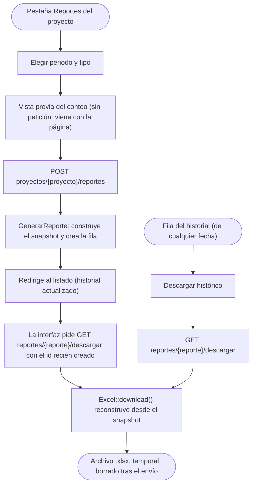

# Módulo: Reportes

## Propósito

Cerrar un periodo produce un archivo que se le manda al cliente, y deja un registro
permanente de qué se le mandó y cuándo. Hay dos reportes por periodo: el **completo**
(uso interno, incluye los pagos) y el **de cliente** (lo que sale de la aplicación hacia
afuera). Se generan bajo demanda -no hay ningún `.xlsx` guardado en disco- y cada
generación deja una fila en `reportes` con una fotografía exacta de lo exportado, para
poder responder meses después "¿qué vio el cliente en marzo?" sin depender de que
alguien conservara el correo.

## Modelo de datos

Una sola tabla nueva, **`reportes`**:

| Columna | Contenido |
|---|---|
| `proyecto_id`, `periodo_id` | A qué periodo pertenece. |
| `tipo` | `TipoReporte`: `completo` o `cliente`. |
| `nombre_archivo` | `{PREFIJO}_P{consecutivo}_{fecha}_{tipo}.xlsx`. |
| `filtros` | JSON: `{periodo_id, tipo}` -lo que se pidió-. |
| `resumen_estados` | JSON: conteo por estado, los seis siempre presentes. |
| `snapshot` | JSON: las filas exactas exportadas. Ver más abajo. |
| `total_tareas` | Entero, coincide con la suma de `resumen_estados`. |
| `hash` | `sha1` del `snapshot` serializado. |
| `generado_por`, `generado_en` | Quién y cuándo. |

**No hay columna de ruta de archivo.** Si aparece una, alguien está guardando los Excel
en disco y la trazabilidad pasó a depender de que ese archivo siga ahí -exactamente lo
que el snapshot evita.

El registro es permanente: `ReportePolicy::delete` siempre niega, y regenerar crea una
fila nueva en lugar de sobrescribir la anterior.

## Reglas de negocio

Numeradas en `docs/03-dominio.md` §7 (D7.1-D7.7). Resumen:

1. **Dos archivos separados, nunca uno solo** (D7.1): el completo lleva pagos, el de
   cliente no lleva ni la hoja ni una sola celda con ese dato.
2. **No se persisten en disco** (D7.2): generación síncrona, descarga directa.
3. **El snapshot es la trazabilidad** (D7.3): desnormalizado -valores tal como salieron
   al Excel, nunca ids-, con dos modos de descarga, actual e histórica.
4. **Sufijo de tipo obligatorio en el nombre** (D7.4).
5. **Una sola ruta de descarga sirve a las dos** (D7.5): `store()` solo escribe,
   `descargar()` solo lee del snapshot. La «actual» es pedir esa misma ruta con el id
   recién creado.
6. **El snapshot de tipo `cliente` no contiene resumen, notas ni pagos en absoluto**
   (D7.6): no es una hoja que no se pinta, es una clave que la estructura nunca tiene.
7. **La paleta de rellenos del Excel es propia** (D7.7): calibrada para distinguirse en
   blanco y negro, no la de la interfaz.

## Flujo principal

Diagrama con más detalle, incluidas las dos ramas de descarga:
[`../diagramas/flujo-generacion-reporte.md`](../diagramas/flujo-generacion-reporte.md).

Las dos ramas de descarga -la del primer clic tras generar y la de un registro
histórico cualquiera- convergen en el mismo `descargar()`: no hay una segunda forma de
construir el archivo.

## Rutas y controladores

| Método | URI | Controlador | Permiso requerido |
|---|---|---|---|
| GET | `proyectos/{proyecto}/reportes` | `ReporteController@index` | `viewAny` sobre `Reporte` |
| POST | `proyectos/{proyecto}/reportes` | `ReporteController@store` | `create` sobre `Reporte` |
| GET | `reportes/{reporte}/descargar` | `ReporteController@descargar` | `view` sobre el `Reporte` |

## Permisos

| Rol | Puede |
|---|---|
| Administrador | Ver el listado, generar y descargar los dos tipos. |
| Líder | Ver el listado, generar y descargar los dos tipos. |
| Colaborador | Ver el listado, generar y descargar los dos tipos. |
| Observador | Ver el listado y descargar. **No puede generar**: generar escribe una fila con el snapshot, y eso es escritura. |
| Cliente | Nada. 403 en el listado y al generar -`ResolverRolProyecto::veLoInterno()` es falso para el rol de proyecto `cliente`, y el reporte completo además lleva dinero-. |

## Decisiones de diseño

**Por qué el snapshot va desnormalizado.** Guardar `modulo_id` en vez del nombre del
módulo parece más "correcto" -es la fuente de verdad, no una copia-, pero rompe la
trazabilidad: si el módulo `Facturación` se renombra a `Cuentas por Cobrar` en octubre,
reconstruir en noviembre el reporte de julio con ese id mostraría el nombre nuevo, y el
archivo dejaría de ser lo que de verdad se le mandó al cliente en julio. Lo mismo pasa
con el nombre de la tarea, su descripción y la etiqueta del estado: todo se congela como
texto en el momento de generar. La prueba que lo demuestra
(`tests/Feature/Reportes/SnapshotTest.php`) renombra un módulo y cambia el estado de una
tarea **después** de generar, y comprueba que la descarga histórica no se entera.

**Por qué una sola ruta de descarga y no dos generaciones distintas.** La alternativa
obvia era que `store()` generara el archivo y lo devolviera directamente en la misma
respuesta, y que `descargar()` fuera una ruta aparte que reconstruyera desde el
snapshot. Eso son dos caminos de construcción del Excel -uno desde datos en vivo, otro
desde el snapshot- que pueden divergir con el tiempo sin que ninguna prueba lo note. Al
hacer que `store()` solo escriba y la interfaz pida la descarga por la ruta histórica
justo después, hay un único código que construye el archivo, y "actual" es
simplemente "el snapshot más reciente".

**Por qué la columna «Notas» de la hoja «Tareas» no es redundante con la hoja
«Notas».** La primera es un resumen condensado -las notas de la tarea separadas por
«·»-, pensado para leerse de corrido sin cambiar de hoja. La segunda es el detalle
completo, con fecha y autor de cada una, pensado para auditar quién dijo qué y cuándo.
Son dos granularidades del mismo dato, no una repetición.

**Por qué el reporte de cliente incluye las tareas canceladas.** El prompt de la fase
solo lo exige explícitamente para el completo ("el periodo se facturó por el trabajo
hecho, y el trabajo descartado también consumió tiempo"), pero nada dice que el cliente
deba ver un subconjunto distinto de tareas -el reporte de cliente cambia qué
**columnas** se ven, no qué **filas**. Mantener el mismo conjunto de tareas en los dos
reportes evita una segunda regla de filtrado sin especificar, y es más transparente: el
cliente ve que una tarea se canceló, no un hueco sin explicar en la numeración.

**Por qué la paleta de rellenos del Excel es una paleta nueva y no una lectura de
`app.css`.** Se intentó primero derivar los seis rellenos directamente de los colores
`--estado-*-fondo` del tema, en modo claro. El resultado: los seis fondos tienen una
luminosidad casi idéntica (entre 232 y 245 sobre 255, en la fórmula de luma
0.299R+0.587G+0.114B) porque están calibrados para verse "pálidos" en una pantalla a
color, no para distinguirse sin color. Convertidos a blanco y negro, los seis colapsan
en el mismo gris casi blanco -exactamente la trampa que este paso del prompt advertía.
`PaletaEstadoExcel` fija en cambio un salto deliberado de luminosidad (de ~237 a ~168
sobre 255) entre los seis, manteniendo el matiz de cada familia para quien lo ve en
color. Con seis pasteles genuinamente pálidos el rango disponible es estrecho -"pálido"
implica luminosidad alta por definición-, así que la separación depende también de que
la columna «Estado» siempre lleve el nombre del estado en texto negro al lado: el color
ayuda, el texto es lo que garantiza la lectura en cualquier condición de impresión.

**Por qué `GenerarReporte` es una `Action` y no un `Service`.** Seguido el patrón ya
existente de `AbrirPeriodo`/`CerrarPeriodo`: una operación con un resultado claro
-construir y persistir un `Reporte`-, invocable (`__invoke`), sin estado propio entre
llamadas. `App\Services\**` en este proyecto son piezas más transversales
(`ResolverRolProyecto`, `ConsultarTrm`) que varias acciones consultan.

## Puntos de extensión

- **Nuevas columnas en una hoja existente**: se añaden en `GenerarReporte` (la fila del
  snapshot) y en el `Export` de esa hoja (`headings()`, `array()`,
  `registerEvents()` si necesitan formato propio). Los dos tienen que cambiar juntos: el
  snapshot es lo que se lee, el `Export` es cómo se pinta.
- **Un tercer tipo de reporte**: añadir un caso a `TipoReporte`, una rama en
  `GenerarReporte::__invoke()` que arme el snapshot correspondiente -pensando primero
  qué claves *no* debe tener, siguiendo D7.6-, y una clase `Hoja*Export` o
  `Reporte*Export` nueva.
- **Si algún día un reporte tarda de verdad**: mover la generación a una cola es un
  cambio acotado a `GenerarReporte` y al método `store()` -devolver un job en cola en
  lugar de crear la fila directamente-, sin tocar `descargar()` ni el formato de las
  hojas.
