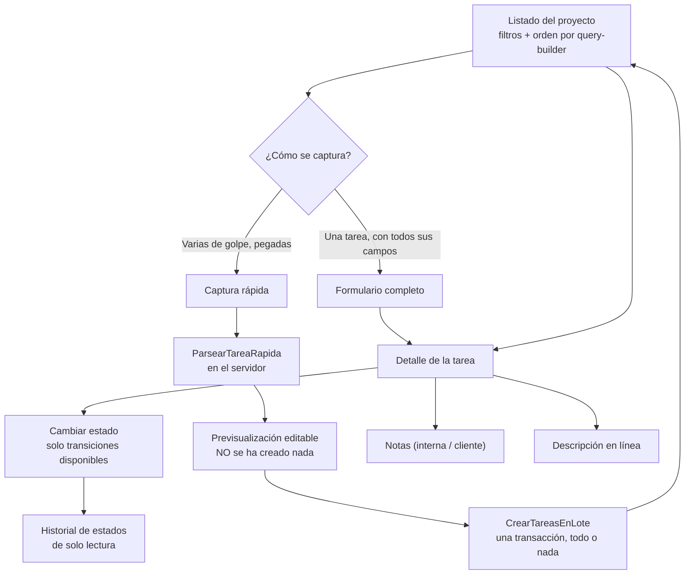

# Módulo: Tareas

> Modelo de datos y reglas de negocio escritos en la **fase 03**; rutas, controladores,
> permisos, captura rápida y flujo de interfaz completados en la **fase 06**; el listado
> pasó al componente `TablaDatos` en la **fase 07**.

## Propósito

Una tarea es la unidad de trabajo del sistema: lo que se hace, para quién y en qué
punto está. Pertenece a un proyecto, opcionalmente a un módulo y a un periodo, y lleva
un código correlativo que la identifica ante el cliente (`POR-0042`). Todo lo demás del
sistema —periodos, reportes, bitácora— existe para contar tareas o para explicarlas.

## Modelo de datos

Tablas: **`tareas`**, **`notas_tarea`**, **`historial_estados`**, **`contadores_tarea`**
y el pivote **`reunion_tarea`**. Diccionario completo en
[`../02-modelo-de-datos.md`](../02-modelo-de-datos.md).

Lo que hay que tener presente:

- **Tres columnas independientes de clasificación**: `estado`, `tipo`, `prioridad`.
- **Dos claves foráneas a `periodos`**: `periodo_id` (el actual) y `periodo_origen_id`
  (de dónde se arrastró). Ambas `set null`: borrar un periodo no borra su trabajo.
- **Una clave foránea a sí misma**: `tarea_origen_id`, la entrega que originó esta
  corrección. También `set null`.
- **`modulo_id` es opcional y `set null`.** Una tarea sin módulo es válida; borrar un
  módulo no borra sus tareas.
- **`motivo_espera` y `motivo_cancelacion` son campos distintos.**
- **Borrado suave.** Una tarea borrada sigue en la base con `deleted_at`.
- **Adjuntos por Medialibrary**: colecciones `imagenes` (con conversión `miniatura`) y
  `documentos` (sin conversiones).

Relaciones del modelo `Tarea`: `proyecto`, `modulo`, `periodo`, `periodoOrigen`,
`origen`, `correcciones`, `creadoPor`, `notas`, `historial`, `reuniones`. Scopes:
`delProyecto`, `porEstado`, `activas`, `arrastradas`, `visiblesPara`.

## Reglas de negocio

1. **Estado, tipo y prioridad son tres ejes independientes** (D1.1). "Corrección" y
   "Soporte" son **tipos**, no estados (D1.2).
2. **El tipo no cambia** una vez creada la tarea (D1.3). El formulario de edición ni
   siquiera lo acepta.
3. **La prioridad se precarga** en `alta` para `correccion` y `soporte`, en `media` para
   el resto. Es un valor por defecto, no una restricción (D1.4).
4. **Solo son válidas las once transiciones de la matriz** (D2.1). Ver
   [`../diagramas/ciclo-de-vida-tarea.md`](../diagramas/ciclo-de-vida-tarea.md).
5. **`en_espera` significa falta de información o de recursos, y nada más** (D2.2). No
   existe `terminada → en_espera` (D2.3).
6. **`entregada` y `cancelada` son terminales** (D2.6, D2.7). Un fallo posterior a la
   entrega crea una tarea nueva de tipo `correccion`, **vinculada por
   `tarea_origen_id`** (D3.3).
7. **`terminada` no se cancela** (D2.8).
8. **Pasar a `en_espera` exige `motivo_espera`; pasar a `cancelada` exige
   `motivo_cancelacion`** (D2.9). Se limpian al salir del estado, pero el texto queda en
   el historial.
9. **Toda transición pasa por `CambiarEstadoTarea`** (D2.12); la validación y el
   historial siguen en `TareaObserver` (D2.10, D2.11).
10. **`fecha_inicio` no se sobrescribe; `fecha_fin` sí** (D2.13, D2.14).
11. **El servidor dice qué transiciones están disponibles** (D2.15). La interfaz no
    deduce la matriz.
12. **El código es correlativo por proyecto y continuo de por vida** (D3.1), y sale de
    un contador con bloqueo, no de `max(codigo) + 1` (D3.2).
13. **No se registran horas** en ninguna parte (D1.5).
14. **Las notas nacen `interna`** (D6.1); la exclusión del cliente se aplica en la
    consulta, no en la interfaz (D6.2).
15. **Toda tarea nace en el periodo abierto del proyecto.** Si no hay ninguno abierto,
    nace con `periodo_id` nulo y la interfaz lo advierte **antes** de crearla.

## Flujo principal



El detalle del cambio de estado, paso a paso, está en
[`../diagramas/flujo-cambio-de-estado.md`](../diagramas/flujo-cambio-de-estado.md).

## Rutas y controladores

| Método | URI | Controlador | Permiso requerido |
|---|---|---|---|
| GET | `tareas` | `ListadoDeTareasController` | Ninguno: lo acota `Tarea::scopeVisiblesPara()` |
| GET | `proyectos/{proyecto}/tareas` | `TareaController@index` | `TareaPolicy@viewAny` |
| GET | `proyectos/{proyecto}/tareas/crear` | `TareaController@create` | `TareaPolicy@create` |
| POST | `proyectos/{proyecto}/tareas` | `TareaController@store` | `TareaPolicy@create` |
| GET | `tareas/{tarea}` | `TareaController@show` | `TareaPolicy@view` |
| GET | `tareas/{tarea}/editar` | `TareaController@edit` | `TareaPolicy@update` |
| PUT | `tareas/{tarea}` | `TareaController@update` | `TareaPolicy@update` |
| DELETE | `tareas/{tarea}` | `TareaController@destroy` | `TareaPolicy@delete` |
| PUT | `tareas/{tarea}/estado` | `EstadoTareaController@update` | `TareaPolicy@cambiarEstado` |
| GET | `proyectos/{proyecto}/tareas/rapida` | `CapturaRapidaController@create` | `TareaPolicy@create` |
| POST | `proyectos/{proyecto}/tareas/rapida/previsualizar` | `CapturaRapidaController@previsualizar` | `TareaPolicy@create` |
| POST | `proyectos/{proyecto}/tareas/rapida` | `CapturaRapidaController@store` | `TareaPolicy@create` |
| GET | `tareas/{tarea}/notas` | `NotaTareaController@index` | `NotaTareaPolicy@viewAny` |
| POST | `tareas/{tarea}/notas` | `NotaTareaController@store` | `NotaTareaPolicy@create` |

Piezas de apoyo:

- **`App\Services\CambiarEstadoTarea`** — puerta única de la transición.
- **`App\Services\ParsearTareaRapida`** — el parser de captura rápida.
- **`App\Actions\CrearTareasEnLote`** — crea el lote confirmado en una transacción.
- **`App\Exceptions\VinculoDeOrigenInvalido`** — las cuatro invariantes del vínculo.

### Filtros y orden del listado

Todo por `spatie/laravel-query-builder`, con `Tarea::scopeVisiblesPara()` aplicado
**antes** que cualquier filtro.

| `filter[…]` | Comportamiento |
|---|---|
| `estado`, `tipo`, `prioridad`, `periodo_id` | Exacto |
| `modulo_id` | **Incluye los submódulos.** Filtrar por "Clientes" trae también las de "Clientes › Facturación" |
| `arrastradas` | `1` deja solo las que tienen `periodo_origen_id` |
| `texto` | Parcial sobre `nombre`, `codigo` y `descripcion` a la vez |

`sort`: `codigo`, `nombre`, `estado`, `prioridad`, `fecha_fin`, `updated_at`. Prefijo `-`
para descendente, y **varios campos separados por coma** (`sort=-prioridad,codigo`): la
posición en la lista es la prioridad del desempate. Paginación del lado del servidor, de
30 por defecto y acotada a 15, 30, 50 o 100 por `por_pagina`.

### La pantalla del listado (fase 07)

El listado usa **`TablaDatos`** —ver [`tabla-de-datos.md`](tabla-de-datos.md)— y ya no una
tabla propia. Lo que aporta la declaración de columnas de `tareas/Index.vue`:

| Columna | Ordena | Filtra | Notas |
|---|---|---|---|
| Código | ✔ | — | Monoespaciada, **anclada** a la izquierda y no ocultable. Lleva pegada la barra de prioridad |
| Tipo | — | ✔ | Icono monocromo |
| Nombre | ✔ | ✔ (texto libre) | El filtro busca a la vez en nombre, código y descripción |
| Módulo | — | ✔ | **Ruta completa**: «Clientes › Facturación», no solo el último tramo |
| Estado | ✔ | ✔ | Badge con relleno de color |
| Prioridad | ✔ | ✔ | Barra + etiqueta; se entiende sin color |
| Periodo | — | ✔ | |
| Fecha de fin | ✔ | — | Monoespaciada |
| Arrastrada | — | ✔ | **Nace oculta**: importa al cerrar un periodo, no todos los días |

Es el único listado **seleccionable** de la fase. Su acción en lote —copiar los códigos
de las filas marcadas al portapapeles— no necesita servidor y es lo que se hace de verdad
al armar un correo o un reporte; mover tareas de periodo en bloque es trabajo posterior.

La ruta del módulo se resuelve con `ArbolDeModulos::rutasDe()`, **una consulta por página**
y no una por fila. `Modulo::rutaCompleta()` sigue existiendo para el detalle, donde hay
una sola tarea y el coste es irrelevante.

### El listado global (fase 07b)

`GET /tareas` sirve **todas las tareas visibles del usuario, de todos sus proyectos**.
Existe porque hasta la fase 07b la pantalla que más se usa no era un destino: había que
entrar a un proyecto y buscar su pestaña.

Los dos listados pintan **la misma página**, `tareas/Index.vue`. Lo que los distingue es
la prop `proyecto`: cuando llega `null` no hay proyecto, aparece la columna «Proyecto» en
lugar de las de módulo y periodo, y desaparecen las acciones de crear. Dos copias de una
página de 300 líneas divergirían en la primera columna que alguien añadiera.

Diferencias con el listado de un proyecto:

| | Proyecto | Global |
|---|---|---|
| Orden por defecto | `codigo` | **`-updated_at`** |
| Columna «Proyecto» | — | ✔, filtrable |
| Filtro por módulo | ✔, con submódulos | — |
| Filtro por periodo | ✔ | — |
| Módulo mostrado | Ruta completa | Solo el nombre |
| Crear / captura rápida | ✔ | — |

Las tres últimas tienen el mismo motivo: **son cosas de un proyecto**. El código
correlativo no ordena nada útil cuando cada proyecto tiene su propia serie; el filtro por
módulo recorre el árbol de *un* proyecto y aquí hay tantos árboles como proyectos; y
resolver la ruta completa exigiría cargar todos esos árboles para pintar una página.

**La autorización aquí es el scope, no una policy.** `TareaPolicy@viewAny` pregunta por un
proyecto y aquí no hay uno solo; lo que acota las filas es `visiblesPara()`, que ya es
obligatorio en todo listado de tareas. Pedir explícitamente un proyecto ajeno
(`filter[proyecto_id]`) devuelve vacío, no sus tareas, porque el scope va antes que el
filtro. `ListadoGlobalTest` lo comprueba.

Se llega desde tres sitios: la entrada «Tareas» del menú principal, el conteo de tareas
abiertas del listado de proyectos —que enlaza al global ya filtrado por ese proyecto y por
los estados abiertos— y la pestaña «Tareas» del concentrador de proyecto, que lleva al
listado del proyecto.

## Captura rápida

Un campo único que acepta la forma en que ya se escribe:

```
nombre | estado | descripción | módulo
```

Solo el **nombre** es obligatorio. Ejemplos reales y lo que produce cada uno:

| Línea pegada | Resultado |
|---|---|
| `migracion de interfaz de clientes \| Pendiente \| se debe migrar la interfaz \| Clientes` | Los cuatro campos separados; módulo `Clientes` reconocido |
| `revisar el calculo del IVA` | Solo nombre; estado `pendiente`; sin descripción ni módulo |
| `ajustar el pie del PDF \| En Proceso \| falta el NIT` | Estado `en_proceso`; sin módulo |
| `corregir el filtro \| EN_PROCESO \| ignora el ultimo dia \| Reporteria` | Módulo inexistente: **se ofrece crearlo**, no se falla |
| `exportar a Excel \| Congelada \| ya esta en pruebas \| Clientes` | Estado irreconocible: cae a `pendiente` **con aviso** |
| `el total sale mal \| En proceso \| pasa con descuento \| y con IVA \| Clientes` | El `\|` de más se queda en la descripción; el módulo se toma del final |
| *(línea en blanco)* | Se salta sin avisar; la numeración conserva la línea original |
| `algo bloqueado \| En espera \| falta el acceso` | Se marca que ese estado **exige motivo**, y la previsualización lo pide |

El estado se reconoce con tolerancia a acentos, mayúsculas, espacios y guiones bajos:
`En Proceso`, `en proceso` y `EN_PROCESO` son el mismo.

## Permisos

| Rol | Puede |
|---|---|
| Administrador | Todo (entra por `Gate::before`) |
| Líder | Crear, editar, mover, borrar, comentar, captura rápida |
| Colaborador | Crear, editar, mover y comentar. **No borra** (`delete` exige `gestiona`) |
| Observador | Ver el listado, el detalle y el historial. No escribe nada |
| Cliente | Ver el listado y el detalle. Solo las notas marcadas `Visibilidad::Cliente` |

Y por encima, el rol global: un `invitado` no escribe nada ni ve lo interno, aunque su
rol de proyecto sea `lider`.

## Decisiones de diseño

### El estado tiene endpoint propio, separado del formulario

**Elegido:** `PUT tareas/{tarea}/estado`, autorizado con `cambiarEstado` y no con
`update`.

**Descartado — `estado` como un campo más del formulario general.** Bastaría con enviarlo
entre los demás para saltarse la matriz por descuido, y la prueba
`no deja cambiar el estado desde el formulario general de edición` es la que lo fija:
manda `estado: entregada` junto al nombre y comprueba que el nombre cambia y el estado no.

La separación tiene además una razón que llega en la fase 08: el Kanban mueve tarjetas sin
tocar ningún otro campo, y ese permiso puede evolucionar aparte.

### El servidor envía las transiciones disponibles

**Descartado — que Vue calcule la matriz.** Sería la **cuarta** copia —enum, skill,
diagrama y cliente— y la única que `MatrizDeTransicionesTest` no comprueba. El día que
cambie una transición, las tres copias del servidor se actualizarían juntas y el
navegador seguiría ofreciendo un botón que devuelve 422.

Cada transición viaja además con `requiere_motivo`, que trae **el nombre del campo**
(`motivo_espera` o `motivo_cancelacion`) y no un booleano: son campos distintos y el
formulario tiene que enviar el correcto.

### El parser vive en el servidor, no en Vue

Se puede probar de verdad —diez líneas mezcladas en una prueba de Pest, no en un navegador
— y un futuro import desde archivo lo reutiliza sin reescribirlo. La interfaz solo pinta
lo que el servidor devolvió.

### El parser nunca rechaza una línea

Un estado irreconocible cae a `pendiente` con aviso; un módulo inexistente se propone
crear. **Rechazar la línea obligaría a corregir el texto original y volver a pegar**, que
es exactamente la fricción que hace que la captura rápida se abandone y se vuelva al
cuaderno.

La única excepción de fondo son los estados que exigen motivo: se aceptan, se marcan, y la
previsualización pide el texto. Degradarlos a `pendiente` en silencio sería perder
información que el usuario acaba de escribir; crearlos sin motivo rompería D2.9.

### El módulo se lee desde el final de la línea

`nombre | estado | descripción | módulo` es posicional, pero una descripción con `|`
dentro es frecuente y un nombre de módulo con `|` no existe. Partir desde la izquierda
hacía que `el total sale mal | En proceso | pasa con descuento | y también con IVA` acabara
proponiendo crear un módulo llamado *"y también con IVA"*.

Tomando el módulo del último campo y dejando el resto a la descripción, el caso frecuente
sale bien y el raro no se pierde.

### La creación en lote es todo o nada

Diez líneas pegadas de un correo son **una sola intención**. Que entren seis y fallen
cuatro deja al usuario sin saber cuáles repetir, y repetir el pegado completo duplicaría
las seis que sí entraron.

### `fecha_inicio` no se sobrescribe y `fecha_fin` sí

No es una asimetría accidental. `fecha_inicio` responde "¿cuándo se empezó?" y volver de
`en_espera` no es empezar de nuevo: sobrescribirla borraría cuánto llevaba abierta la
tarea. `fecha_fin` responde "¿cuándo quedó lista?", y si la revisión falló y hubo que
retocar, la fecha honesta es la del segundo intento — que es la que el cliente ve en el
reporte del periodo.

### El vínculo de corrección es `set null`, no `cascade`

Si se borrara la entrega original y con ella sus correcciones, el periodo en que se
hicieron esas correcciones dejaría de contarlas. Una corrección es trabajo hecho y cobrado;
el vínculo con su origen es contexto, no dependencia vital.

### El código sale de una tabla de contadores, no de `max(codigo) + 1`

**Alternativa descartada: `max(codigo) + 1`.** Es lo primero que uno escribe y falla de
dos maneras. Con dos creaciones simultáneas, ambas leen el mismo máximo y piden el mismo
número: una de las dos revienta contra el `unique` de `codigo`, y eso es el mejor caso —
el peor es que el `unique` no exista. Y con borrado, incluso forzado, el máximo baja y
un código ya usado se vuelve a entregar; el cliente recibe dos veces "POR-0042" hablando
de cosas distintas.

**Alternativa descartada: `lockForUpdate()` sobre las tareas del proyecto.** Funciona,
pero bloquea un conjunto de filas que crece sin límite y sigue derivando el número de lo
que hay en la tabla, así que no arregla el problema del borrado.

**Elegido: `contadores_tarea`**, una fila por proyecto, bloqueada con `lockForUpdate()`
dentro de una transacción. El número no depende de las tareas existentes, así que ningún
borrado lo hace retroceder, y el bloqueo es sobre una sola fila. La fila la crea
`ProyectoObserver` al nacer el proyecto, de modo que dos tareas simultáneas del mismo
proyecto nunca compiten por insertarla. El `unique` de `codigo` sigue ahí como última
red, no como primera.

### El historial se escribe en `updated`, no en `updating`

La skill de la fase 02 decía `updating`. Se cambió: en `updating` el UPDATE todavía no
se ha ejecutado, y si falla después —interbloqueo, restricción— queda en el historial un
cambio de estado que nunca ocurrió. La validación sí va en `updating`, porque tiene que
poder abortar el guardado y limpiar los motivos antes de que se escriban.

### Los estados se guardan como `varchar`, no como `ENUM` de MySQL

Un `ENUM` de MySQL da integridad a nivel de motor, pero alterarlo obliga a reconstruir
la tabla. Pesa más el caso de `historial_estados`: guarda estados que pueden dejar de
existir en el enum de PHP, y un registro histórico no puede quedar inválido porque el
dominio evolucione.

### Ordenar por prioridad usa el peso del enum

Ordenar por la columna daría `alta, baja, critica, media` —alfabético y sin ningún
sentido—. El orden se construye con un `CASE` derivado de `PrioridadTarea::peso()`, de
modo que añadir una prioridad nueva no obliga a tocar el SQL.

## Puntos de extensión

- **Kanban** (fase 08). Mueve tarjetas llamando al mismo `PUT tareas/{tarea}/estado`, que
  ya devuelve las transiciones disponibles del estado nuevo. La columna `orden` está para
  eso y todavía no se usa.
- **Editor enriquecido en las notas** (fase 10). Hoy son texto plano; TipTap sustituye el
  `textarea` sin tocar el modelo, que ya guarda `contenido`.
- **Arrastre de tareas al cerrar un periodo** (fase 09). `periodo_origen_id` y el scope
  `arrastradas` ya existen; falta la acción que las mueve al cerrar.
- **Nuevos estados.** Añadir un caso a `EstadoTarea` obliga a tocar tres sitios: el enum,
  la skill y el diagrama. `MatrizDeTransicionesTest` falla hasta que los tres coinciden,
  que es exactamente lo que se quiere. Los tokens de color del tema son el cuarto.
- **Nuevos tipos.** El caso al enum, su clave en `lang/{es,en}/enums.php` y su icono en
  `IconoTipo.vue`. No llevan color propio.
- **Import desde archivo.** Reutiliza `ParsearTareaRapida` tal cual: recibe texto y
  devuelve filas.
