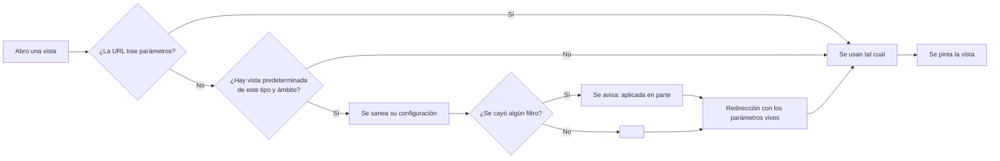

# Módulo: Vistas

> Escrito en la **fase 08**. Cubre las cuatro formas de ver las mismas tareas y el
> modelo de vistas guardadas.

## Propósito

Las mismas tareas se miran para cosas distintas, y una sola forma de enseñarlas obliga a
leerlas todas de la misma manera. Este módulo da **cuatro**: una tabla para comparar
valores entre filas, un tablero para ver en qué estado está cada cosa y moverla, una
lista para repasar un proyecto entero de arriba abajo, y un calendario para ver qué
vence cuándo.

Y da una forma de **volver a lo que ya habías montado**: una vista guardada es un
nombre y unos filtros, y se aplica de un clic.

## Las cuatro vistas, y para qué sirve cada una

| Vista | Ruta | Cuándo se usa |
|---|---|---|
| **Tabla** | `proyectos/{p}/tareas` | Comparar valores entre filas: ordenar por fecha, ver qué columna falta, exportar con la vista puesta. Es la única con orden multicolumna, columnas ocultables y paginación. |
| **Tablero** | `proyectos/{p}/tablero` | Ver el reparto del trabajo y **moverlo**. Es la única donde se arrastra. |
| **Lista** | `proyectos/{p}/lista` | Repasar un proyecto entero antes de una reunión: qué hay en cada módulo, sin desplazarse a lo ancho. |
| **Calendario** | `proyectos/{p}/agenda` | Qué vence cuándo. |

**No hay una quinta.** Cuatro ya son muchas para mantener, y las que sobran acaban
desactualizándose respecto a las que se usan.

### Qué comparten y qué no

Comparten los **filtros**, y eso no es casualidad: los declara `FiltrosDeTareas` en un
solo sitio. Un filtro que existiera en el listado y no en el tablero convertiría cambiar
de vista en perder lo que habías buscado, que es la peor forma de perderlo, sin aviso.

No comparten el orden multicolumna, las columnas visibles ni la paginación: son cosas de
una tabla. Por eso `useEstadoDeTabla` se partió en la fase 08 y el núcleo
(`useEstadoEnLaUrl`) es lo único que usan las otras tres.

## Modelo de datos

Solo las vistas guardadas persisten algo. Las cuatro vistas leen de `tareas`.

`vistas_guardadas`:

| Columna | Qué es |
|---|---|
| `usuario_id` | Dueño. Las vistas son privadas. |
| `proyecto_id` | Nulo = vale en todos los proyectos. |
| `nombre` | Lo que se ve en el selector. |
| `tipo` | `tabla`, `kanban`, `lista` o `calendario` (`TipoDeVista`). |
| `configuracion` | JSON con **los mismos parámetros que viajan en la URL**. |
| `es_predeterminada` | Se aplica al entrar sin parámetros. |
| `marca_predeterminada` | **Columna generada.** Vale 1 si la anterior es cierta y NULL si no. |

## Reglas de negocio

1. **Una vista guardada es un nombre y una cadena de consulta.** Como el estado de toda
   vista vive en la URL desde la fase 07, no hace falta ningún formato propio: guardar es
   guardar los parámetros, y aplicar es navegar.
2. **Son privadas de cada usuario.** No se comparten, y ni siquiera un administrador
   alcanza la de otro.
3. **Una sola predeterminada por usuario y tipo**, garantizado por la base de datos.
4. **Duplicar nunca hereda la marca de predeterminada.**
5. **El tipo y el ámbito se fijan al crear.** No se editan.
6. **Aplicar una vista tolera referencias muertas**: un filtro que apunta a algo que ya
   no existe se ignora y se avisa una vez de que se aplicó en parte.
7. **La predeterminada solo se aplica en una URL desnuda.** Si la petición ya trae
   parámetros, no pisa nada.

## Flujo principal

## Rutas y controladores

| Método | URI | Controlador | Permiso |
|---|---|---|---|
| GET | `proyectos/{p}/tablero` | `TableroController@index` | `viewAny` sobre `Tarea` |
| GET | `proyectos/{p}/tablero/columna` | `TableroController@columna` | `viewAny` sobre `Tarea` |
| GET | `proyectos/{p}/lista` | `ListaAgrupadaController@index` | `viewAny` sobre `Tarea` |
| GET | `proyectos/{p}/agenda` | `AgendaDeTareasController@index` | `viewAny` sobre `Tarea` |
| PUT | `proyectos/{p}/tareas/orden` | `ReordenarTareasController@update` | `moverEnTablero` |
| PUT | `proyectos/{p}/tareas/{t}/columna` | `MoverTareaEnTableroController@update` | `moverEnTablero` |
| PUT | `tareas/{t}/estado` | `EstadoTareaController@update` | `cambiarEstado` |
| POST | `vistas` | `VistaGuardadaController@store` | Propiedad de la fila |
| PUT | `vistas/{v}` | `VistaGuardadaController@update` | Propiedad de la fila |
| POST | `vistas/{v}/duplicar` | `VistaGuardadaController@duplicar` | Propiedad de la fila |
| DELETE | `vistas/{v}` | `VistaGuardadaController@destroy` | Propiedad de la fila |

## Permisos

| Rol | Puede |
|---|---|
| Administrador | Todo, salvo tocar las vistas guardadas de otro. |
| Líder | Ver las cuatro vistas, mover y reordenar tarjetas. |
| Colaborador | Igual que el líder para las tareas. |
| Observador / Cliente | Ver. No mueve ni reordena; el tablero se lo dice en pantalla, y la ruta lo rechaza igualmente. |

## Decisiones de diseño

### El tablero tiene endpoint propio, no un parámetro sobre el listado

Un paginador plano y un conjunto de columnas con su total son **formas de datos
distintas**. Forzarlas en la misma respuesta las hace peores a las dos: el listado
acabaría devolviendo columnas vacías y el tablero un `last_page` que no significa nada.

Lo que sí se comparte —los filtros— se comparte de verdad, en `FiltrosDeTareas`.

### Cuatro consultas, agrupe por lo que agrupe

La forma ingenua es un `LIMIT` por columna más las relaciones de cada tarjeta. Con eso,
agrupar por estado son seis consultas y agrupar por módulo son más de veinte: **el
tablero sería más lento cuanto mejor organizado estuviera el proyecto**, que es
exactamente al revés de lo que debería.

`ArmarTablero` usa una función de ventana (`ROW_NUMBER() OVER (PARTITION BY …)`) que
numera las filas dentro de cada columna y descarta las que pasan del tope. Son cuatro
consultas fijas: las tarjetas, los totales y las dos relaciones.

El total se cuenta aparte porque **no es el número de tarjetas cargadas**. Sin eso, una
columna con doscientas entregadas diría «50» y el tablero mentiría sobre cuánto trabajo
hay en cada sitio.

### «Cargar más» va en JSON, no como recarga parcial

Una recarga parcial de Inertia rearma el tablero entero. Pedir veinte tarjetas más de
«Entregada» recalcularía las seis columnas y sus seis totales.

### El límite por columna existe porque nadie mira la tarjeta 180

Cincuenta por columna. Una columna con doscientas entregadas no se trae entera: arrastrar
se vuelve pesado mucho antes de llegar al final, y el total sigue diciendo la verdad.

### Los grupos plegados de la lista viven en memoria, no en la URL

Es una preferencia de lectura de quien está mirando ahora —como la densidad de fila de la
tabla—, no parte de lo que se comparte. Mandar «las tareas del módulo X» con ese grupo
plegado sería mandar una pantalla que esconde justo lo que se quería enseñar.

### El calendario enseña las tareas sin fecha

Van a una franja aparte y visible, con su total. **Un calendario que esconde lo que no
encaja en su rejilla no es una vista del trabajo, es una vista de la rejilla**: enseñaría
veinte tareas cuando el proyecto tiene ochenta, y las sesenta que faltan serían justo las
que nadie ha fechado todavía.

Sin arrastre entre días: mover una fecha de fin tiene consecuencias de periodo que la
fase 09 todavía no ha definido.

### Las vistas guardadas son privadas, y eso se resuelve con la consulta

`Gate::before` deja pasar al administrador por encima de todas las policies. Para los
datos de un proyecto está bien —tiene que poder entrar a arreglar lo que sea—, pero una
vista guardada no es un dato del proyecto: es la preferencia de una persona, y no hay
ningún permiso que deba conceder renombrar la de otro.

Por eso cada método de `VistaGuardadaController` busca la fila **entre las del usuario de
la sesión** y responde 404 si no está. 404 y no 403: confirmar que existe ya diría que
otra persona tiene una vista con ese id.

**Alternativa descartada: compartirlas.** Suena bien y no lo es —dos personas con la
misma vista guardada acaban discutiendo sobre qué debería mostrar—. El día que haga falta
se añade un campo; hoy la ausencia de ese campo es la decisión.

### «Una sola predeterminada» lo garantiza la base, no la interfaz

Ni MySQL ni SQLite tienen índices únicos parciales, así que se consigue con una **columna
generada** que vale 1 cuando la vista es la predeterminada y NULL cuando no lo es: un
índice único ignora los NULL en los dos motores, así que las no predeterminadas conviven
y las predeterminadas chocan.

Dejarlo en manos de la interfaz o de un observer significa que dos pestañas abiertas, un
comando de consola o un seeder pueden dejar dos marcadas, y entonces «la predeterminada»
pasa a ser la que devuelva primero el motor: un valor que cambia solo.

El controlador desmarca la anterior antes de marcar la nueva. Eso es cortesía, no la
cerradura: sin ello el usuario tendría que desmarcar a mano para poder marcar.

### Aplicar una vista tolera referencias muertas

Una vista guardada en julio filtra por un módulo que en noviembre puede no existir. Hay
dos formas malas de responder: **reventar** —la vista deja de abrirse y nadie sabe por
qué— o **filtrar por un id inexistente** y devolver cero filas fingiendo que no hay
trabajo. Se hace la tercera: se ignora lo que ya no existe, se aplica el resto y se avisa
**una vez** de que se aplicó parcialmente.

Ojo a la asimetría deliberada: un `filter[modulo_id]` puesto a mano en la barra de
direcciones **sí** devuelve cero filas. Lo que tolera referencias muertas es aplicar una
vista guardada, no filtrar por un id que no existe.

### La predeterminada se aplica navegando, no en silencio

Redirige a la URL con sus parámetros. Así la barra de direcciones dice qué se está viendo
y el enlace se puede compartir; aplicarla en silencio dejaría una pantalla filtrada cuya
URL no explica por qué.

### Las etiquetas de columna se resuelven en el servidor

En el resto del proyecto, `etiqueta()` de un enum devuelve la **clave** y la traduce quien
la pinta. En el tablero y la lista no se puede: sus etiquetas mezclan claves de enum con
**rutas de módulo**, que son texto literal. Pasarlas todas por `$t` pintaría la ruta del
módulo como si fuera una clave rota.

Así que estas tres vistas mandan la etiqueta ya resuelta. Los enums siguen devolviendo
claves, como todos los demás.

## Puntos de extensión

- **Otra agrupación**: un caso más en `AgrupacionTablero`, su columna en `columna()`, y
  añadirlo al subconjunto de la vista que la admita (`delTablero()` / `deLaLista()`). Si
  la columna nueva es editable, hay que decidir **por cuál de los tres caminos** se mueve.
- **Arrastre en el calendario**: pasa por decidir qué hace mover una `fecha_fin` respecto
  al periodo. Es trabajo de la fase 09.
- **Compartir vistas**: un campo en `vistas_guardadas` y una policy que mire algo más que
  `usuario_id`. Léase antes la decisión de arriba.
